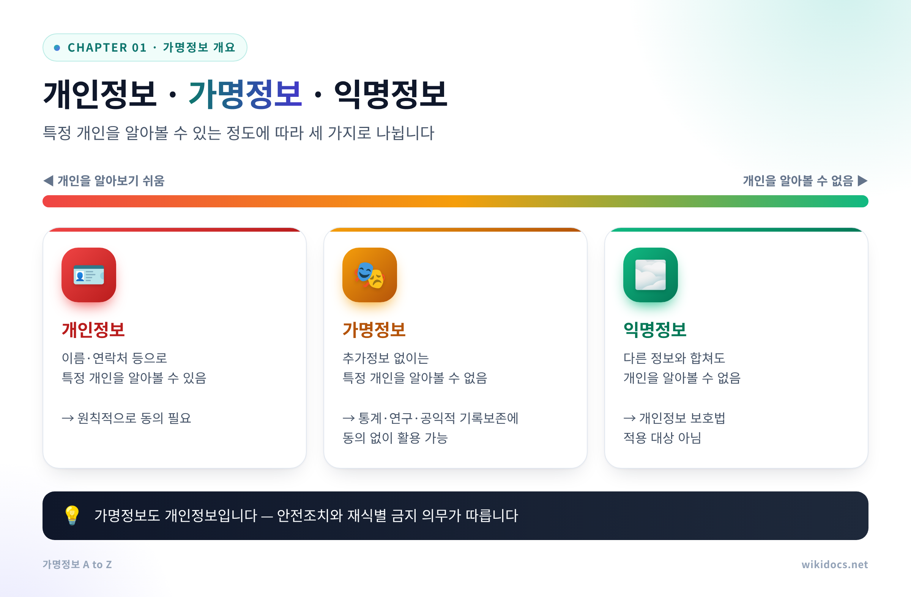

<!--
**상태**: 🔵 검토 중
**분류**: 01. 가명정보 개요
**태그**: #개념 #정의
**작성일**: 2026-11-22
-->
> 📅 **최종 확인**: 2026-11-22

데이터를 다루는 일을 하다 보면 "이건 개인정보인가요, 가명정보인가요?"라는 질문을 자주 받습니다. 이 구분에 따라 **동의가 필요한지, 어떤 의무가 따르는지**가 달라집니다. 이 페이지에서는 개인정보 보호법의 정의를 바탕으로 세 가지 정보를 구분합니다.

## 요약

- **개인정보**: 살아 있는 개인을 알아볼 수 있는 정보입니다. 다른 정보와 쉽게 결합해 알아볼 수 있는 정보도 포함합니다.
- **가명정보**: 가명처리를 해서 **추가정보 없이는** 특정 개인을 알아볼 수 없는 정보입니다. 가명정보도 **개인정보의 한 종류**입니다.
- **익명정보**: 다른 정보를 사용해도 **더 이상 개인을 알아볼 수 없는** 정보입니다. 개인정보 보호법이 적용되지 않습니다.

## 법에서 말하는 세 가지 정보



| 구분 | 법적 근거 | 핵심 기준 | 예시 (가상) |
|---|---|---|---|
| 개인정보 | 제2조 제1호 가목·나목 | 그 자체로, 또는 다른 정보와 **쉽게 결합**해 개인을 알아볼 수 있음 | 홍길동, 010-1234-5678, 고객번호와 연결된 구매 내역 |
| 가명정보 | 제2조 제1호 다목 | **추가정보**의 사용·결합 없이는 특정 개인을 알아볼 수 없음 | 이름 삭제 + 고객번호를 임의 코드로 바꾼 구매 내역 |
| 익명정보 | 제58조의2 | 시간·비용·기술 등을 합리적으로 고려할 때 다른 정보를 사용해도 개인을 알아볼 수 없음 | 지역·연령대별 평균 구매액 통계표 |

## 핵심 개념: 가명처리와 추가정보

**가명처리**(제2조 제1호의2)는 개인정보의 일부를 삭제하거나, 일부 또는 전부를 대체하는 등의 방법으로 **추가정보가 없이는 특정 개인을 알아볼 수 없도록** 처리하는 것입니다.

**추가정보**는 가명정보를 다시 원래 개인정보로 되돌릴 때 쓸 수 있는 정보입니다. 예를 들어 "고객번호 ↔ 임의 코드" 대응표가 추가정보입니다.

```text
[원본 개인정보]
이름: 홍길동 | 고객번호: C-10293 | 나이: 37 | 구매액: 152,000원

        ↓ 가명처리 (이름 삭제, 고객번호 대체, 나이 범주화)

[가명정보]
코드: P-8841 | 나이대: 30대 | 구매액: 152,000원

[추가정보 — 분리 보관]
C-10293 ↔ P-8841
```

[[TIP("핵심")]]

가명정보와 익명정보를 가르는 기준은 **되돌릴 수 있는가**입니다. 추가정보가 있으면 다시 개인을 알아볼 수 있으므로 가명정보이고, 어떤 방법으로도 합리적으로 알아볼 수 없으면 익명정보입니다.

[[/TIP]]

## 헷갈리기 쉬운 경우

| 상황 | 판단 | 이유 |
|---|---|---|
| 이름만 지우고 휴대폰 번호는 남김 | 개인정보 | 휴대폰 번호로 개인을 알아볼 수 있음 |
| 이름을 지우고 회원번호를 임의 코드로 바꿈, 대응표는 따로 보관 | 가명정보 | 대응표(추가정보)가 있으면 되돌릴 수 있음 |
| 대응표를 파기했지만 희귀 질환·작은 지역 정보가 남아 있음 | 개인정보 또는 가명정보일 수 있음 | 남은 정보 조합으로 개인을 알아볼 가능성 |
| 1,000명 이상 집단의 평균값만 남김 | 익명정보에 가까움 | 개인 단위 정보가 없음 |

[[TIP("주의")]]

"이름을 지웠으니 익명정보"라고 판단하면 안 됩니다. 남은 항목들(생년월일, 우편번호, 직업 등)의 **조합**으로 개인을 알아볼 수 있는지까지 따져야 합니다. 재식별 위험 평가는 04장에서 자세히 다룹니다.

[[/TIP]]

## 실무 체크포인트

- [ ] 데이터에 개인을 직접 알아볼 수 있는 항목(이름, 연락처, 고유번호)이 남아 있지 않은가
- [ ] 남은 항목의 조합으로 특정 개인을 알아볼 가능성을 검토했는가
- [ ] 추가정보(대응표, 암호키 등)를 가명정보와 분리해 보관하고 있는가
- [ ] 익명정보라고 판단했다면 그 근거를 문서로 남겼는가

## 근거·출처

| 구분 | 출처 | 위치 | 비고 |
|---|---|---|---|
| 법령 | [개인정보 보호법 (국가법령정보센터)](https://www.law.go.kr/법령/개인정보보호법) | 제2조 제1호, 제1호의2, 제58조의2 | 정의 |
| 가이드라인 | [가명정보 처리 가이드라인 (2024.2. 개정)](https://www.pipc.go.kr/np/cop/bbs/selectBoardArticle.do?bbsId=BS217&mCode=D010030000&nttId=9900) | 개인정보보호위원회 | 가명처리 개념 |

## 관련 페이지

- 01-2. 도입 배경 (2020 데이터 3법 개정)
- 01-3. 처리 가능 목적
- 📚 04-6. 프라이버시 모델
