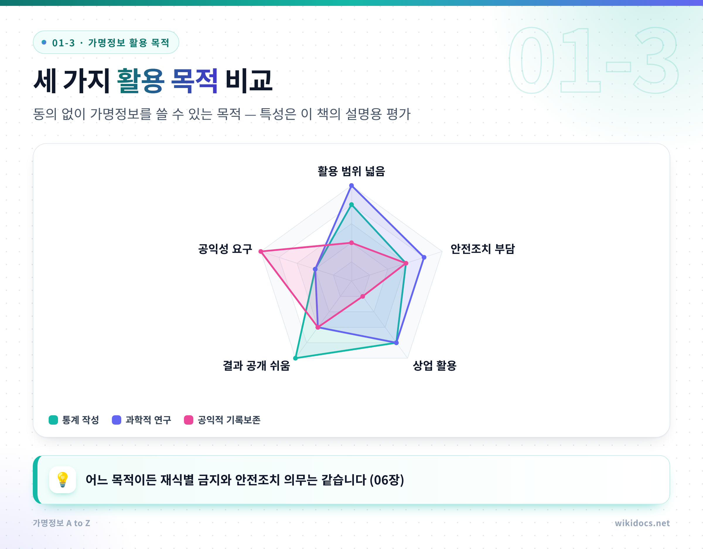
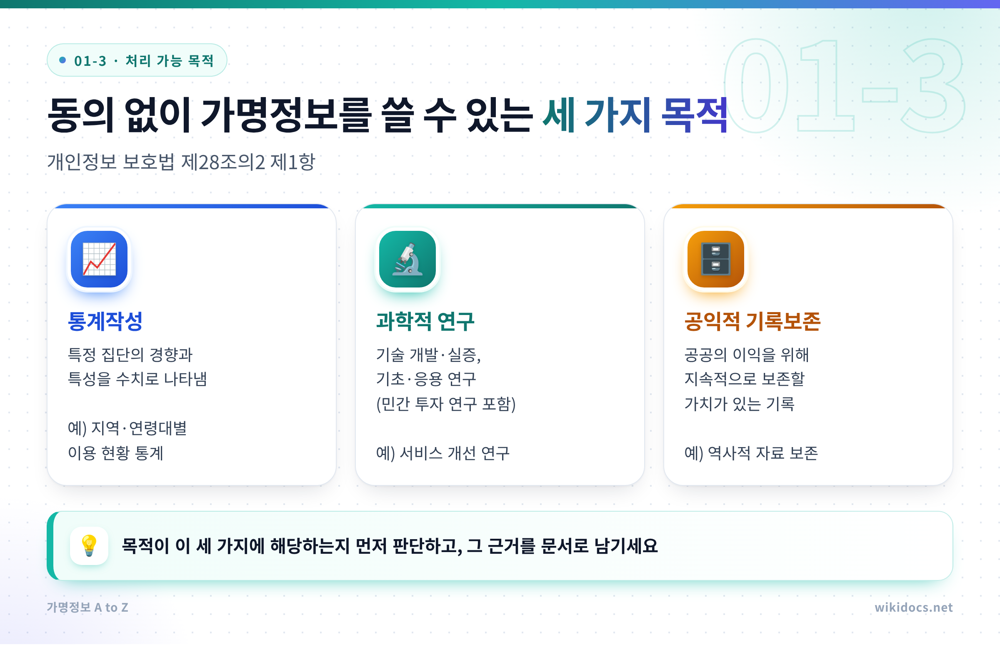

<!--
**상태**: 🔵 검토 중
**분류**: 01. 가명정보 개요
**태그**: #목적
**작성일**: 2026-11-22
-->
> 📅 **최종 확인**: 2026-11-22

가명정보는 아무 목적에나 동의 없이 쓸 수 있는 것이 아닙니다. 개인정보 보호법은 **세 가지 목적**에 한해 정보주체의 동의 없이 가명정보를 처리할 수 있게 합니다. 이 페이지에서는 각 목적의 의미와 판단 방법을 정리합니다.

## 요약

- 동의 없이 가명정보를 처리할 수 있는 목적은 **통계작성, 과학적 연구, 공익적 기록보존**입니다. (제28조의2 제1항)
- 가이드라인은 **상업적 목적의 통계작성**과 **산업적 목적의 연구**도 포함될 수 있다고 설명합니다.
- 어떤 목적인지 **구체적으로 정하고 문서로 남기는 것**이 모든 절차의 출발점입니다.



## 세 가지 목적



| 목적 | 의미 | 예시 (가상) |
|---|---|---|
| 통계작성 | 특정 집단이나 대상의 경향과 특성을 수치로 나타내는 것 | 지역·연령대별 카드 이용 현황 통계, 시간대별 매장 방문 통계 |
| 과학적 연구 | 기술의 개발과 실증, 기초연구, 응용연구, 민간 투자 연구 등 과학적 방법을 적용하는 연구 (제2조 제8호) | 진료 데이터로 질병 예측 모델 연구, 서비스 이용 데이터로 추천 알고리즘 개선 연구 |
| 공익적 기록보존 | 공공의 이익을 위해 지속적으로 열람할 가치가 있는 정보를 기록·보존하는 것 | 역사적 사건 관련 자료 보존, 공공기관의 중요 기록 보존 |

[[TIP("알아두기")]]

통계작성과 과학적 연구는 **공공 목적에만 한정되지 않습니다.** 가이드라인은 기업이 시장 분석을 위해 통계를 만들거나 새로운 제품·서비스 개발을 위해 연구하는 것도 해당될 수 있다고 설명합니다. 다만 목적이 실제로 통계·연구에 해당하는지는 구체적으로 판단해야 합니다.

[[/TIP]]

## 해당하지 않는 경우 예시

| 상황 | 판단 | 이유 |
|---|---|---|
| 가명정보로 특정 고객에게 맞춤 광고 문자 발송 | ❌ 해당 안 됨 | 특정 개인을 대상으로 하는 처리이며, 재식별 금지 의무에도 어긋날 수 있음 |
| 가명정보를 다른 회사에 제공 | ⚠️ 신중한 검토 필요 | 제3자 제공은 가능하나 목적이 통계·연구 등에 해당해야 하고, 특정 개인을 알아보는 데 쓰일 수 있는 정보를 포함하면 안 됨 |
| 연령대별 이용 패턴 통계를 내서 마케팅 전략 수립 | ✅ 해당 가능 | 상업적 목적의 통계작성 |

## 목적을 정할 때 할 일

```text
1. 목적을 한 문장으로 쓰기
   예) "20~30대 고객의 시간대별 앱 이용 패턴을 분석해 서비스 개선 연구에 활용"

2. 세 가지 목적 중 어디에 해당하는지 판단하고 근거 적기

3. 목적 달성에 꼭 필요한 항목만 고르기 (불필요한 항목은 처리 대상에서 제외)

4. 위 내용을 사전 준비 서류(가명처리 계획 등)에 기록
```

이 과정은 03장의 **1단계: 목적 설정 등 사전 준비**에서 자세히 다룹니다.

## 실무 체크포인트

- [ ] 처리 목적을 구체적인 한 문장으로 적었는가
- [ ] 세 가지 목적 중 어디에 해당하는지 근거를 남겼는가
- [ ] 목적에 필요 없는 항목을 처리 대상에서 뺐는가
- [ ] 특정 개인을 대상으로 하는 활용(맞춤 광고 등)이 섞여 있지 않은가

## 근거·출처

| 구분 | 출처 | 위치 | 비고 |
|---|---|---|---|
| 법령 | [개인정보 보호법 (국가법령정보센터)](https://www.law.go.kr/법령/개인정보보호법) | 제2조 제8호, 제28조의2 | 목적·정의 |
| 가이드라인 | [가명정보 처리 가이드라인 (2024.2. 개정)](https://www.pipc.go.kr/np/cop/bbs/selectBoardArticle.do?bbsId=BS217&mCode=D010030000&nttId=9900) | 개인정보보호위원회 | 목적별 해설 |

## 관련 페이지

- 01-1. 개인정보·가명정보·익명정보의 구분
- 01-2. 도입 배경
- 📚 03-1. 1단계: 목적 설정 등 사전 준비
