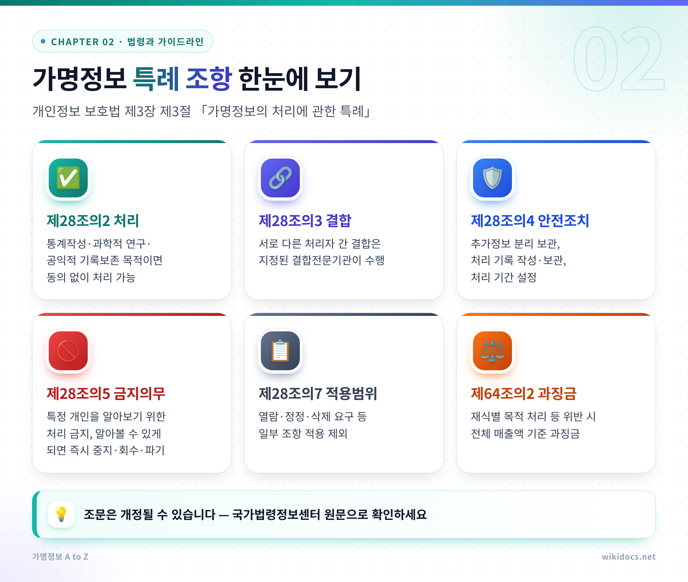

<!--
**상태**: 🔵 검토 중
**분류**: 02. 법령과 가이드라인
**태그**: #법령
**작성일**: 2026-11-22
-->
> 📅 **최종 확인**: 2026-11-22

가명정보의 처리 근거와 의무는 개인정보 보호법 **제3장 제3절 「가명정보의 처리에 관한 특례」**에 모여 있습니다. 이 페이지는 실무자가 꼭 알아야 할 조항을 **"무엇을 할 수 있고, 무엇을 지켜야 하는가"** 관점으로 정리합니다.

[TOC]

## 요약

- **할 수 있는 것**: 통계작성·과학적 연구·공익적 기록보존 목적이면 정보주체 동의 없이 가명정보를 처리할 수 있습니다. (제28조의2)
- **지켜야 할 것**: 결합은 전문기관을 통해서(제28조의3), 추가정보 분리·기록 보관 등 안전조치(제28조의4), 재식별 금지(제28조의5).
- **위반하면**: 재식별 목적 처리 등은 과징금 대상입니다. (제64조의2, 02-4 참고)

## 가명정보 특례 조항 한눈에 보기

## 조항별 정리

| 조항 | 핵심 내용 | 실무에서 할 일 |
|---|---|---|
| 제2조 제1호 다목, 제1호의2 | 가명정보·가명처리의 정의 | 데이터가 가명정보에 해당하는지 판단 (01-1) |
| 제28조의2 (가명정보의 처리 등) | 통계작성·과학적 연구·공익적 기록보존 목적이면 동의 없이 처리 가능. 제3자에게 제공할 때 특정 개인을 알아보기 위해 사용될 수 있는 정보를 포함하면 안 됨 | 목적을 문서로 정하고, 제공 시 식별 가능 정보 제거 |
| 제28조의3 (가명정보의 결합 제한) | 서로 다른 개인정보처리자의 가명정보 결합은 지정된 결합전문기관이 수행 | 결합은 직접 하지 말고 전문기관에 신청 (05장) |
| 제28조의4 (가명정보에 대한 안전조치의무 등) | 추가정보 분리 보관 등 안전조치, 처리 기록 작성·보관. 2023년 개정으로 처리 기간을 정할 수 있게 됨 | 추가정보 분리, 처리 기록, 기간 경과 시 파기 (06장) |
| 제28조의5 (가명정보 처리 시 금지의무 등) | 특정 개인을 알아보기 위한 처리 금지. 알아볼 수 있는 정보가 생기면 즉시 처리 중지·회수·파기 | 재식별 모니터링, 발생 시 대응 절차 |
| 제28조의7 (적용범위) | 가명정보에는 일부 조항(정보주체의 열람·정정·삭제 요구 등) 적용 제외 | 적용 제외 범위를 정확히 확인 |
| 제58조의2 (적용제외) | 다른 정보를 사용해도 더 이상 개인을 알아볼 수 없는 정보(익명정보)에는 법 미적용 | 익명 판단 근거 기록 |
| 제64조의2 (과징금의 부과) | 위반 시 과징금 (전체 매출액 기준) | 02-4 참고 |

[[TIP("주의: 조문은 바뀝니다")]]

개인정보 보호법은 2023년 3월 크게 개정되었고, 이후에도 개정이 이어지고 있습니다. 조항 번호와 문구는 실무 적용 전에 반드시 **국가법령정보센터의 현행 원문**으로 확인하세요. 이 페이지는 법률 자문이 아니라 실무 안내입니다.

[[/TIP]]

## 예시: 조항이 실제로 적용되는 장면

**상황:** 온라인 쇼핑몰이 "연령대별 구매 패턴 통계"를 만들어 마케팅 전략에 쓰려고 합니다.

| 질문 | 관련 조항 | 판단 |
|---|---|---|
| 고객 동의를 다시 받아야 하나? | 제28조의2 | 통계작성 목적의 가명처리이므로 동의 없이 가능 |
| 협력사 데이터와 합쳐도 되나? | 제28조의3 | 직접 합치면 안 됨. 결합전문기관을 통해야 함 |
| 고객번호 대응표는 어디에 두나? | 제28조의4 | 분석 담당자가 접근할 수 없는 곳에 분리 보관 |
| 분석 중 특정 고객이 드러나면? | 제28조의5 | 즉시 처리 중지, 해당 정보 회수·파기 |
| 고객이 가명정보 열람을 요구하면? | 제28조의7 | 가명정보에는 열람 요구 등 일부 조항이 적용되지 않음 (범위 확인 필요) |

## 다른 법률과의 관계

| 분야 | 관련 법률 | 비고 |
|---|---|---|
| 금융·신용정보 | 신용정보의 이용 및 보호에 관한 법률 (신용정보법) | 데이터전문기관을 통한 결합 (05-5) |
| 보건의료 | 개인정보 보호법 + 「보건의료 데이터 활용 가이드라인」 | 민감정보 처리 기준 (02-3) |
| 인공지능 | 인공지능 기본법 (2026.1.22. 시행) | AI 학습 데이터 관련 (08장) |

## 실무 체크포인트

- [ ] 처리 목적이 제28조의2의 세 가지 중 하나인지 확인했는가
- [ ] 외부 데이터와의 결합은 결합전문기관을 거치는가
- [ ] 추가정보를 분리 보관하고 처리 기록을 남기는가
- [ ] 재식별이 발생했을 때의 대응 절차가 있는가
- [ ] 조문을 현행 원문으로 확인했는가

## 근거·출처

| 구분 | 출처 | 비고 |
|---|---|---|
| 법령 | [개인정보 보호법 (국가법령정보센터)](https://www.law.go.kr/법령/개인정보보호법) | 제2조, 제28조의2~제28조의7, 제58조의2, 제64조의2 |
| 개정 해설 | [개인정보 보호법 및 시행령 개정사항 안내 (개인정보보호위원회, 2023.12.)](https://t1.daumcdn.net/brunch/service/user/4qJH/file/D3MZjxVfnFk1F77LauahSERLz50.pdf?download=) | 2023년 개정 |
| 조문 해설 | [개인정보 보호법 제64조의2 (CaseNote)](https://casenote.kr/%EB%B2%95%EB%A0%B9/%EA%B0%9C%EC%9D%B8%EC%A0%95%EB%B3%B4_%EB%B3%B4%ED%98%B8%EB%B2%95/%EC%A0%9C64%EC%A1%B0%EC%9D%982) | 과징금 |

## 관련 페이지

- 02-2. 가명정보 처리 가이드라인 요약
- 02-4. 위반 시 제재
- 📚 01-1. 개인정보·가명정보·익명정보의 구분
- 📚 05-1. 결합 절차 개요
