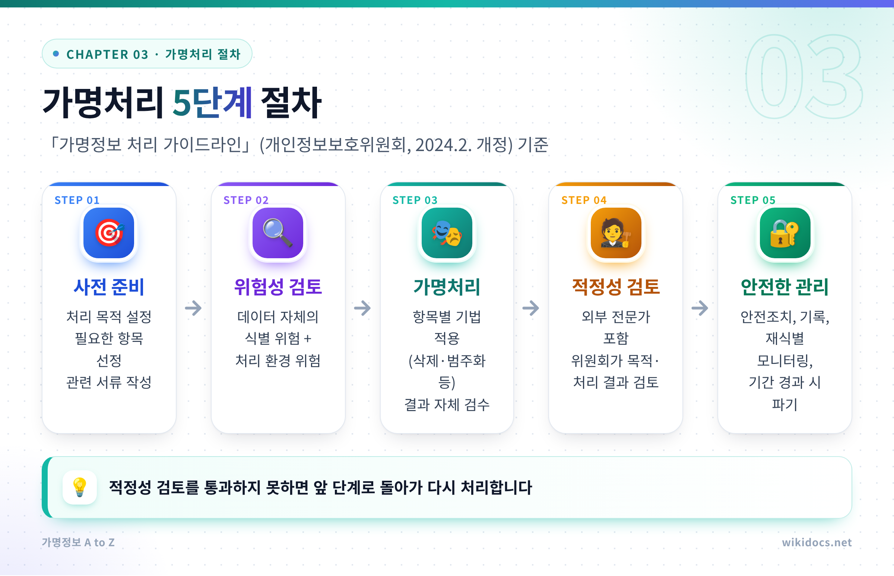

<!--
**상태**: 🔵 검토 중
**분류**: 02. 법령과 가이드라인
**태그**: #가이드라인
**작성일**: 2026-11-22
-->
> 📅 **최종 확인**: 2026-11-22

법은 원칙을 정하고, 실제로 "어떻게 하면 되는가"는 개인정보보호위원회의 **「가명정보 처리 가이드라인」**이 안내합니다. 가명처리 실무의 기준서이므로, 이 책의 03~05장도 이 가이드라인을 바탕으로 합니다.

## 요약

- 가이드라인은 2020년 처음 발간되었고, 2022년 4월, **2024년 2월** 개정되었습니다.
- 가명처리 절차를 **5단계**(사전 준비 → 위험성 검토 → 가명처리 → 적정성 검토 → 안전한 관리)로 안내합니다.
- 2024년 개정에서는 **비정형 데이터**(이미지·영상·음성·텍스트) 가명처리 기준과 시나리오 예시가 추가되었습니다.

## 가이드라인의 구성 (요약)

| 영역 | 주요 내용 | 이 책의 관련 장 |
|---|---|---|
| 개념과 원칙 | 가명정보·가명처리·추가정보의 개념, 처리 목적 | 01장 |
| 처리 절차 | 5단계 절차와 단계별 서류 | 03장 |
| 가명처리 기법 | 삭제·일반화·암호화·무작위화 등 기법과 예시 | 04장 |
| 비정형 데이터 | 이미지·영상·음성·텍스트의 식별 위험과 처리 방법, 시나리오 예시 | 04-7 |
| 안전조치 | 추가정보 분리, 접근 통제, 기록 관리 | 06장 |
| 부록 | 서식 예시, 사례 | 각 장 |

## 5단계 절차

| 단계 | 핵심 질문 | 결과물 예 |
|---|---|---|
| 1. 목적 설정 등 사전 준비 | 무엇을 위해, 어떤 항목이 필요한가? | 처리 목적서, 대상 항목 목록 |
| 2. 위험성 검토 | 데이터 자체와 처리 환경의 식별 위험은? | 위험성 검토 결과 |
| 3. 가명처리 | 항목마다 어떤 기법을 쓸까? 결과는 적절한가? | 가명처리 내역, 자체 검수 결과 |
| 4. 적정성 검토 | 외부 전문가를 포함한 위원회가 보기에 적정한가? | 적정성 검토 결과서 |
| 5. 안전한 관리 | 추가정보 분리, 기록, 재식별 모니터링, 파기 | 처리 기록, 파기 기록 |

[[TIP("2024년 개정의 핵심: 비정형 데이터")]]

AI 학습 데이터로 사진·음성·문서를 쓰는 경우가 늘면서, 가이드라인은 비정형 데이터 가명처리 기준과 **7가지 시나리오 예시**를 추가했습니다. 또 AI 학습·연구개발 시 기술 특성에 맞는 위험 완화 조치와, AI 서비스 운영 중 **지속적인 모니터링**이 필요하다고 설명합니다. (04-7, 08장 참고)

[[/TIP]]

## 함께 보면 좋은 공식 안내서

| 자료 | 발행 | 언제 보나 |
|---|---|---|
| 가명정보 처리 가이드라인 (2024.2. 개정) | 개인정보보호위원회 | 가명처리 전반 |
| 「가명정보의 결합 및 반출 등에 관한 고시」 | 개인정보보호위원회 | 결합·반출 절차 (05장) |
| 합성데이터 생성·활용 안내서, 합성데이터 생성 참조모델 | 개인정보보호위원회·한국인터넷진흥원 | 합성데이터 활용 (04-8) |
| 생성형 AI 개발·활용을 위한 개인정보 처리 안내서 (2025.8.) | 개인정보보호위원회 | AI 개발·활용 (08장) |
| 보건의료 데이터 활용 가이드라인 | 보건복지부·개인정보보호위원회 | 의료 데이터 (02-3) |
| 금융분야 가명·익명처리 안내서 | 금융위원회·금융감독원 | 금융 데이터 (02-3) |
| 가명정보 활용 우수사례집 | 개인정보보호위원회·한국인터넷진흥원 | 사례 참고 (07장) |

## 실무 체크포인트

- [ ] 최신 개정본(2024.2.) 기준으로 업무 절차를 만들었는가
- [ ] 5단계마다 결과물(서류)을 남기는가
- [ ] 비정형 데이터를 다룬다면 개정 내용을 반영했는가
- [ ] 우리 분야의 별도 가이드라인을 함께 확인했는가

## 근거·출처

| 구분 | 출처 | 비고 |
|---|---|---|
| 가이드라인 | [가명정보 처리 가이드라인 (2024.2. 개정, 개인정보보호위원회)](https://pipc.go.kr/np/cop/bbs/selectBoardArticle.do?bbsId=BS217&mCode=D010030000&nttId=9900) | 원문 |
| 안내 | [가명정보 처리 가이드라인 개정 안내 (개인정보 포털)](https://www.privacy.go.kr/front/bbs/bbsView.do?bbsNo=BBSMSTR_000000000049&bbscttNo=20658) | 개정 요지 |
| 해설 | [가이드라인 개정 해설 (법무법인 세종)](https://www.shinkim.com/kor/media/newsletter/2342) | 비정형 데이터 |
| 안내서 목록 | [개인정보보호위원회 안내서 게시판](https://pipc.go.kr/np/cop/bbs/selectBoardList.do?bbsId=BS217&mCode=D010030000) | 최신 안내서 |

## 관련 페이지

- 02-1. 개인정보 보호법 가명정보 특례 조항
- 02-3. 분야별 가이드라인
- 📚 03장 가명처리 절차
- 📚 04-7. 비정형 데이터 가명처리
