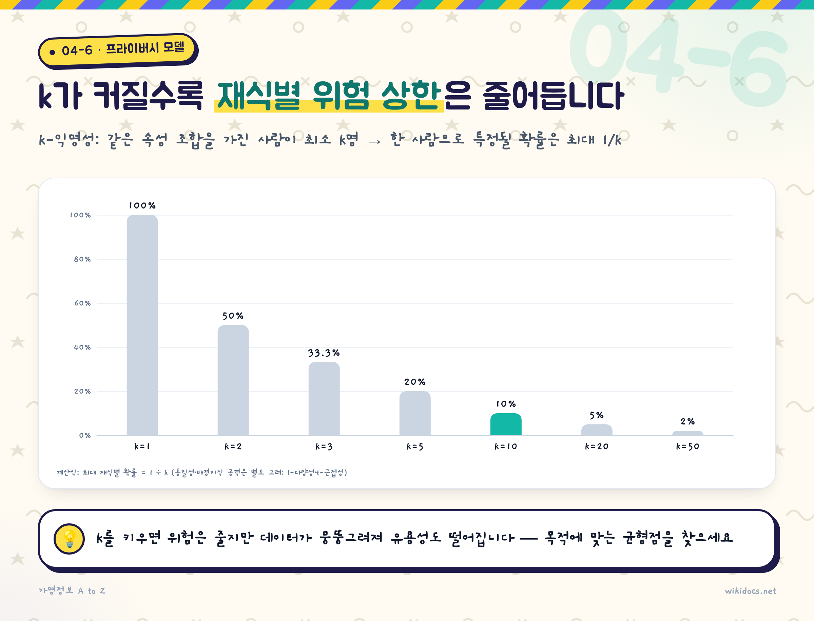
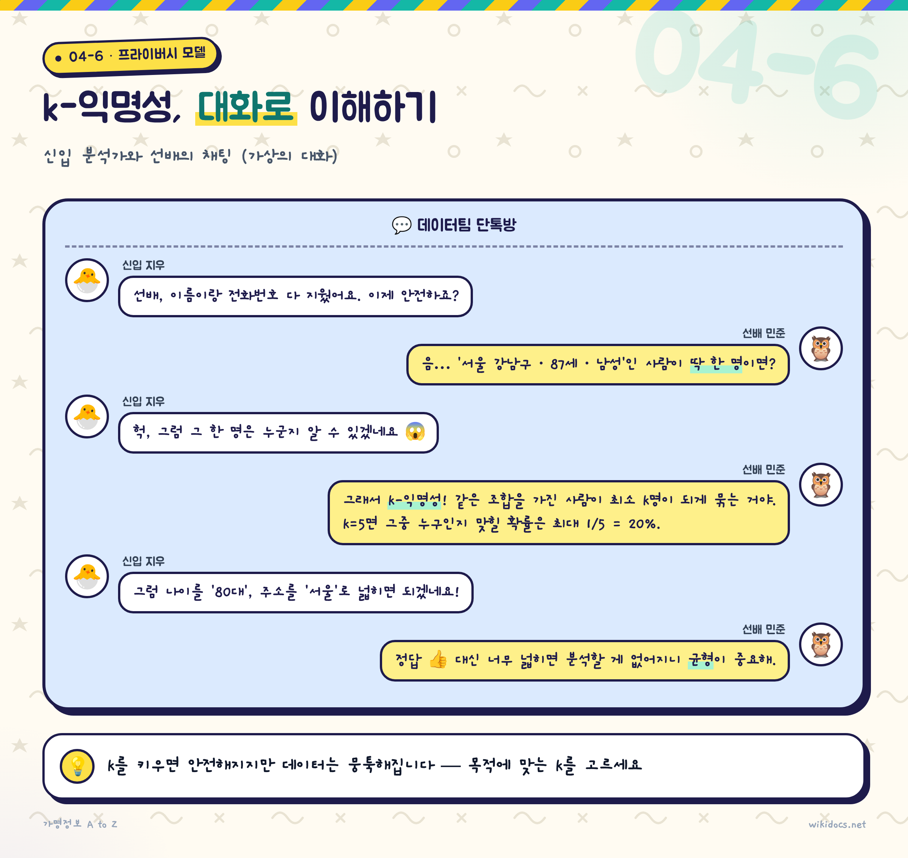

<!--
**상태**: 🔵 검토 중
**분류**: 04. 가명처리 기법
**태그**: #기법 #평가
**작성일**: 2026-11-22
-->
> 📅 **최종 확인**: 2026-11-22

가명처리를 했다면 "이 정도면 충분한가?"를 판단해야 합니다. **프라이버시 모델**은 재식별 위험을 숫자로 재는 기준입니다. 가장 널리 쓰이는 k-익명성부터, 그 약점을 보완한 l-다양성·t-근접성, 그리고 수학적 보장을 주는 차분 프라이버시까지 정리합니다.

[TOC]

## 요약

- **k-익명성**: 준식별자 조합이 같은 사람이 **최소 k명**이 되게 합니다. "나와 같은 사람이 k-1명 더 있다."
- **l-다양성**: 같은 그룹 안의 민감정보(예: 진단)가 **최소 l가지**가 되게 합니다. 그룹 전체가 같은 진단이면 그룹만 알아도 진단이 드러나기 때문입니다.
- **t-근접성**: 그룹 안의 민감정보 분포가 **전체 분포와 크게 다르지 않게** 합니다.





## 준식별자란

이름·연락처처럼 그 자체로 식별되는 정보는 아니지만, **다른 정보와 조합하면 특정인을 가려낼 수 있는 정보**입니다. 생년월일·성별·우편번호·직업이 대표적입니다.

```text
"1958년생, 남성, 우편번호 13487, 의사" → 이 조합에 해당하는 사람은 1명일 수 있음
```

## 예제: k-익명성과 l-다양성 계산

저장소의 `code/02_k_anonymity.py`는 가상 고객 7명으로 처리 단계마다 k와 l을 계산합니다.

```python
def check(records, qi, sensitive="진단"):
    groups = defaultdict(list)
    for r in records:
        groups[tuple(r[c] for c in qi)].append(r[sensitive])
    k = min(len(v) for v in groups.values())          # 가장 작은 그룹의 인원
    l = min(len(set(v)) for v in groups.values())     # 가장 적은 민감정보 종류 수
```

**실행 결과**

```text
[처리 전] 준식별자(생년·성별·우편번호·직업)  k=1, l=1, 혼자인 사람 7명
[범주화 후] 준식별자(연령대·지역·직업)        k=1, l=1, 혼자인 사람 1명
   ↳ 재식별 위험: ('60대', '134', '의사') (1명)
[튀는 레코드 삭제 후]                         k=3, l=2, 혼자인 사람 0명
   그룹 ('40대', '062', '회사원') → 3 명, 진단: ['고혈압', '당뇨']
   그룹 ('30대', '045', '교사') → 3 명, 진단: ['비염', '천식']
```

| 단계 | k | l | 해석 |
|---|---|---|---|
| 처리 전 | 1 | 1 | 모든 사람이 조합으로 특정됨 |
| 범주화 후 | 1 | 1 | 6명은 그룹에 묻혔지만, 1명(60대 의사)이 여전히 혼자 |
| 튀는 레코드 삭제 후 | 3 | 2 | 모든 그룹이 3명 이상, 그룹 안 진단도 2종류 이상 |

## 왜 k-익명성만으로는 부족한가

```text
그룹 ('30대', '045', '교사') 3명의 진단이 모두 '천식'이었다면?
→ k=3이어도, 이 그룹에 속한다는 것만 알면 '천식'이라는 사실이 드러남 (동질성 공격)
→ 그래서 l-다양성(그룹 안 진단 종류 ≥ l)을 함께 봄
```

## 모델 비교

| 모델 | 기준 | 막는 위험 | 한계 |
|---|---|---|---|
| k-익명성 | 같은 조합이 k명 이상 | 조합으로 특정 개인 찾기 | 그룹 전체가 같은 민감정보면 노출 |
| l-다양성 | 그룹 안 민감정보 l종류 이상 | 동질성 공격 | 분포가 치우치면 추론 가능 |
| t-근접성 | 그룹 분포 ≈ 전체 분포 (차이 t 이하) | 분포 차이로 추론 | 분석 유용성 손실 큼 |
| 차분 프라이버시 | 한 사람의 포함 여부가 결과에 주는 영향 ≤ ε | 결과로부터 개인 추론 | 설계·이해가 어려움 (04-8) |

[[TIP("요령: k 값은 고정 공식이 아닙니다")]]

"k는 몇이면 되나요?"에 정답은 없습니다. 데이터를 **누가, 어떤 환경에서** 쓰는지(내부 분석실 vs 외부 제공), 데이터에 **민감정보**가 있는지에 따라 달라집니다. 가이드라인의 **위험성 검토(03-2)** 결과를 바탕으로 정하고, 정한 이유를 적정성 검토 자료에 남기세요.

[[/TIP]]

## 실무 체크포인트

- [ ] 준식별자 목록을 정했는가 (생년·성별·지역·직업 등)
- [ ] 처리 후 k·l 값을 계산해 기록했는가
- [ ] 혼자 튀는 레코드를 처리했는가
- [ ] k·l 기준을 정한 이유를 남겼는가

## 근거·출처

| 구분 | 출처 | 비고 |
|---|---|---|
| 가이드라인 | [가명정보 처리 가이드라인 (2024.2. 개정)](https://pipc.go.kr/np/cop/bbs/selectBoardArticle.do?bbsId=BS217&mCode=D010030000&nttId=9900) | 위험성 검토·적정성 검토 |
| 해외 지침 | [ICO Anonymisation guidance (영국 ICO)](https://ico.org.uk/for-organisations/uk-gdpr-guidance-and-resources/data-sharing/anonymisation/about-this-guidance/) | 식별 위험 평가 |

## 관련 페이지

- 04-2. 범주화·라운딩
- 04-8. 최신 프라이버시 강화 기술
- 📚 03-2. 2단계: 위험성 검토
- 📚 03-4. 4단계: 적정성 검토
