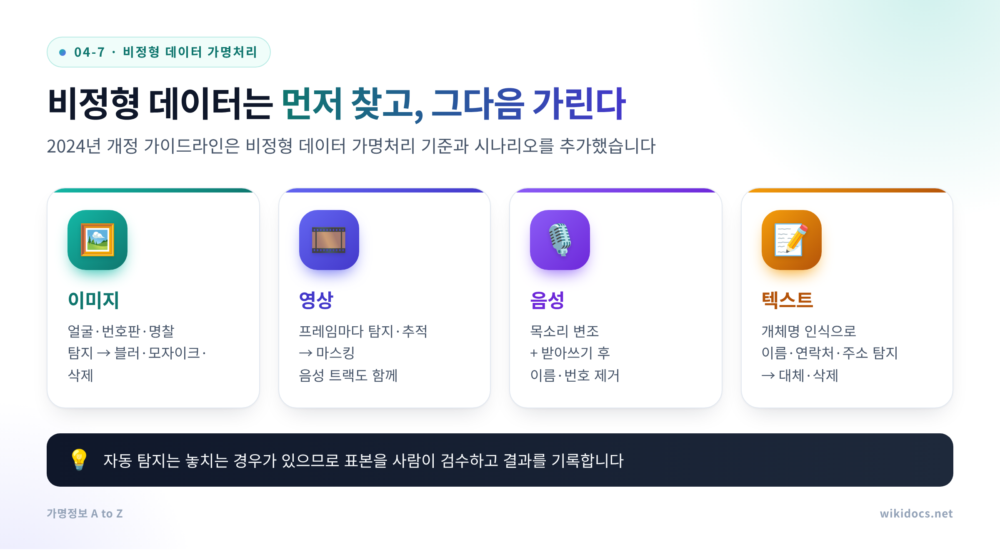

<!--
**상태**: 🔵 검토 중
**분류**: 04. 가명처리 기법
**태그**: #기법 #비정형
**작성일**: 2026-11-22
-->
> 📅 **최종 확인**: 2026-11-24

사진, CCTV 영상, 상담 녹음, 진료 기록 문장처럼 **표 형식이 아닌 데이터**를 비정형 데이터라고 합니다. AI 학습 수요가 커지면서 비정형 데이터의 가명처리가 중요해졌고, 2024년 2월 개정된 가명정보 처리 가이드라인은 비정형 데이터 처리 기준과 시나리오 예시를 추가했습니다.

## 요약

- 비정형 데이터는 식별 정보가 **어디에 있는지부터 찾아야** 합니다. (탐지 → 처리)
- 처리 기술의 **적절성과 신뢰성을 평가하고 근거를 보관**하며, 결과를 **자체 검수**합니다.
- AI 학습에 쓰는 경우, 서비스 운영 중에도 **지속적인 모니터링**이 필요합니다.

## 유형별 처리 방법



| 유형 | 식별 위험 예 | 처리 방법 예 | 검수 포인트 |
|---|---|---|---|
| 이미지 | 얼굴, 차량번호판, 명찰, 문서 속 글자 | 탐지 후 블러·모자이크·삭제, 사진 파일의 촬영 위치·기기 정보 제거 | 작은 얼굴·옆모습 누락 여부 |
| 영상 | 프레임마다 얼굴·번호판, 음성 | 프레임 단위 탐지·추적 후 마스킹, 음성 변조·삭제 | 움직이는 대상 추적 실패 구간 |
| 음성 | 목소리 자체, 말 속의 이름·번호 | 음성 변조, 받아쓰기 후 텍스트 처리, 원본 음성 삭제 | 변조 후 화자 식별 가능성 |
| 텍스트 | 문장 속 이름·연락처·주소·직장 | 개체명 인식으로 탐지 → 대체(`[이름]`)·삭제, 희귀한 표현 일반화 | 오탐·누락 비율 |

## 예시: 상담 기록 텍스트 (가상)

**원문**
```text
3월 5일 김민수 고객님(010-2345-6789)께서 강남구 역삼동 지점 방문,
작년에 ○○병원에서 받은 수술 이후 보험금 청구 문의.
```

**처리 후**
```text
3월 [고객]님([연락처])께서 [지역] 지점 방문,
작년에 [의료기관]에서 받은 수술 이후 보험금 청구 문의.
```

| 처리 | 내용 |
|---|---|
| 직접 식별자 | 이름·연락처 → `[고객]`, `[연락처]` 대체 |
| 준식별자 | 날짜 → 월 단위로 범주화, 지점 위치 → `[지역]` |
| 민감 단서 | 특정 병원 이름 → `[의료기관]` |

[[TIP("요령: 자동 탐지 + 사람 검수")]]

개체명 인식이나 얼굴 탐지 같은 자동 도구는 빠르지만 **놓치는 경우가 있습니다.** 표본을 뽑아 사람이 검수하고, 놓친 비율을 기록하세요. 놓친 비율이 높으면 탐지 기준을 강화하거나 처리 범위를 넓힙니다. 가이드라인도 처리 결과의 **자체 검수**와 **근거 보관**을 강조합니다.

[[/TIP]]

## AI 학습 데이터로 쓸 때

| 단계 | 할 일 |
|---|---|
| 학습 전 | 비정형 데이터 가명처리, 처리 기술의 신뢰성 평가와 근거 보관 |
| 학습·개발 | 기술·서비스 특성에 맞는 위험 완화 조치 (예: 학습 데이터 암기 여부 점검) |
| 서비스 운영 | AI 결과에 개인정보가 나오지 않는지 지속 모니터링 |

자세한 내용은 08장 「AI 시대의 가명정보」에서 다룹니다.

[[TIP("2026년 개정: 대규모 비정형 데이터는 표본 검수 가능")]]

2026년 3월 전면 개정된 가명정보 처리 가이드라인은 영상·이미지·텍스트 같은 대규모 비정형 데이터를 전부 확인하기 어려울 때 **일부를 골라 검수(표본 검수)**할 수 있다고 안내합니다. 이때는 표본을 어떻게 골랐는지, 왜 그 방식을 택했는지, 발견된 문제를 어떻게 보완했는지를 기록으로 남겨야 한다는 해설이 많습니다. (02-2 참고)

[[/TIP]]

## 실무 체크포인트

- [ ] 유형별로 식별 위험이 있는 요소를 목록으로 만들었는가
- [ ] 자동 탐지 결과를 표본 검수하고 누락 비율을 기록했는가
- [ ] 사진·문서 파일의 메타데이터도 제거했는가
- [ ] AI 학습용이라면 운영 중 모니터링 계획이 있는가

## 근거·출처

| 구분 | 출처 | 비고 |
|---|---|---|
| 가이드라인 | [가명정보 처리 가이드라인 (2024.2. 개정)](https://pipc.go.kr/np/cop/bbs/selectBoardArticle.do?bbsId=BS217&mCode=D010030000&nttId=9900) | 비정형 데이터 기준, 시나리오 |
| 해설 | [비정형데이터 가명처리 가이드라인 개정 (법무법인 세종)](https://www.shinkim.com/kor/media/newsletter/2342) | 개정 요지 |
| 요약 | [가명처리 절차 요약 (2024.2.4 개정 기준)](https://yesxyz.kr/summary-of-pseudonymization-procedures/) | 단계별 비정형 처리 |
| 공식 | ['가명정보 가이드라인' 전면 개정 (정책브리핑, 2026.3.)](https://www.korea.kr/news/policyNewsView.do?newsId=148961790) | 표본 검수 |

## 관련 페이지

- 04-8. 최신 프라이버시 강화 기술
- 📚 08-1. LLM에 개인정보를 입력할 때의 위험
- 📚 08-2. AI로 식별자 자동 탐지하기
