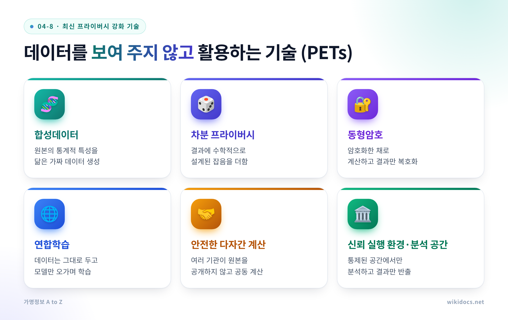

<!--
**상태**: 🔵 검토 중
**분류**: 04. 가명처리 기법
**태그**: #기법 #PETs
**작성일**: 2026-11-22
-->
> 📅 **최종 확인**: 2026-11-22

전통적인 가명처리 기법(삭제·범주화·암호화)은 데이터를 **덜 자세하게** 만들어 보호합니다. 최근에는 데이터를 **보여 주지 않고도** 분석할 수 있게 하는 기술이 빠르게 발전하고 있습니다. 이런 기술을 통틀어 **프라이버시 강화 기술(PETs, Privacy-Enhancing Technologies)**이라고 부릅니다.

[TOC]

## 요약

- **합성데이터**: 원본을 닮은 가짜 데이터를 만들어 원본 대신 씁니다. 개인정보보호위원회가 안내서와 참조모델을 공개했습니다.
- **차분 프라이버시·동형암호·연합학습·다자간 계산**: 결과에 잡음을 넣거나, 암호화한 채로 계산하거나, 데이터를 옮기지 않고 학습합니다.
- PETs는 가명처리를 **대체하기보다 보완**합니다. 어떤 기술이든 재식별 위험 평가는 여전히 필요합니다.

## 6가지 프라이버시 강화 기술



| 기술 | 원리 (쉽게) | 활용 예 | 고려할 점 |
|---|---|---|---|
| 합성데이터 | 원본의 통계적 특성을 학습해 비슷한 가짜 데이터 생성 | AI 학습, 개발·테스트용 데이터, 교육용 데이터 | 원본과 너무 비슷하면 재식별 위험, 너무 다르면 쓸모없음 |
| 차분 프라이버시 | 결과에 수학적으로 설계된 잡음을 더해 "한 사람이 있든 없든 결과가 거의 같게" | 통계 공표, 사용 패턴 수집 | 보호 수준(ε) 설정과 정확도의 균형 |
| 동형암호 | 암호화한 상태로 덧셈·곱셈 등 계산 | 외부 클라우드에 맡기는 민감 계산 | 계산 속도가 느림 |
| 연합학습 | 데이터는 각 기관에 두고, 모델(가중치)만 오가며 학습 | 여러 병원이 환자 데이터를 옮기지 않고 공동 AI 학습 | 모델 갱신값에서 정보가 새지 않도록 보완 필요 |
| 안전한 다자간 계산 | 각자 데이터를 숨긴 채 공동으로 결과만 계산 | 두 회사의 공통 고객 수 계산 | 참여 기관 간 프로토콜 합의 필요 |
| 신뢰 실행 환경·분석 공간 | 통제된 하드웨어·공간에서만 원본 처리, 결과만 반출 | 결합전문기관의 분석 공간, 보안 분석실 | 운영 비용, 반출 심사 |

## 합성데이터: 국내 안내서

개인정보보호위원회는 **「합성데이터 생성·활용 안내서」**와 분야별 **「합성데이터 생성 참조모델」**을 공개했습니다. 보도에 따르면 안내서는 절차를 다섯 단계로 나눕니다.

```text
① 사전 준비 → ② 합성데이터 생성 → ③ 안전성·유용성 검증 → ④ 심의위원회 평가 → ⑤ 활용 및 관리
```

| 검증 | 질문 | 예 |
|---|---|---|
| 유용성 | 원본과 통계적 특성이 비슷한가? | 연령대별 평균 구매액, 변수 간 상관관계 비교 |
| 안전성 | 원본의 특정 개인과 거의 같은 레코드가 있는가? | 합성 레코드와 가장 가까운 원본 레코드의 거리 점검 |

[[TIP("주의: 합성데이터도 자동으로 안전하지 않습니다")]]

희귀한 특성을 가진 사람(예: 60대·희귀질환·특정 지역)이 원본에 있으면, 합성데이터에도 **그 사람과 거의 같은 레코드**가 만들어질 수 있습니다. 반드시 안전성 검증을 거치고, 필요하면 극단값을 먼저 처리한 뒤 생성하세요.

[[/TIP]]

## 예시: 상황별 기술 선택

| 상황 | 추천 조합 |
|---|---|
| 개발팀이 테스트용 고객 데이터가 필요 | 합성데이터 (실제 고객 데이터 대신) |
| 앱 사용 통계를 공개 보고서로 발표 | 범주화 + 차분 프라이버시 |
| 여러 병원이 AI 진단 모델을 함께 학습 | 연합학습 + 각 병원 내부 가명처리 |
| 두 회사가 공통 고객 규모만 알고 싶음 | 안전한 다자간 계산 또는 결합전문기관 결합 (05장) |
| 민감한 결합 데이터를 깊이 분석 | 결합전문기관의 안전한 분석 공간에서 분석 후 결과만 반출 |

## 해외 동향

| 기관 | 내용 |
|---|---|
| EU EDPB | 2025년 1월 가명처리 지침 초안: 키 관리, 일방향 함수 권장, "가명처리 영역" 개념 (09-1) |
| 영국 ICO | 2025년 3월 익명처리·가명처리 최종 지침 공개, PETs 관련 안내도 운영 (09-3) |

## 실무 체크포인트

- [ ] 원본 대신 합성데이터로 충분한 업무를 찾아봤는가
- [ ] 합성데이터의 유용성과 안전성을 모두 검증했는가
- [ ] 여러 기관 협업이라면 데이터를 옮기지 않는 방법(연합학습·다자간 계산)을 검토했는가
- [ ] PETs를 써도 재식별 위험 평가를 했는가

## 근거·출처

| 구분 | 출처 | 비고 |
|---|---|---|
| 보도 | [개인정보위, 합성데이터 참조모델 공개 (문화일보)](https://www.munhwa.com/article/11432786) | 분야별 참조모델 |
| 보도 | [합성데이터 안전성 검증 필요 (ZDNet Korea, 2025.1.)](https://zdnet.co.kr/view/?no=20250110160702) | 안내서 5단계 |
| 자료실 | [한국인터넷진흥원 자료실](https://www.kisa.or.kr/2060301) | 참조모델·안내서 원문 |
| 해외 | [EDPB Guidelines 01/2025 요약](https://www.edpb.europa.eu/system/files/2025-02/edpb_summary_202501_pseudonymisation_en.pdf) | 가명처리 지침 |
| 해외 | [ICO 익명처리 지침 최종본 해설 (Bird & Bird)](https://www.twobirds.com/en/insights/2025/key-takeaways-from-the-ico%E2%80%99s-final-anonymisation-guidance) | 2025.3. |

## 관련 페이지

- 04-6. 프라이버시 모델
- 04-7. 비정형 데이터 가명처리
- 📚 05-3. 결합 후 반출 심사
- 📚 08-4. 합성데이터와 가명정보
