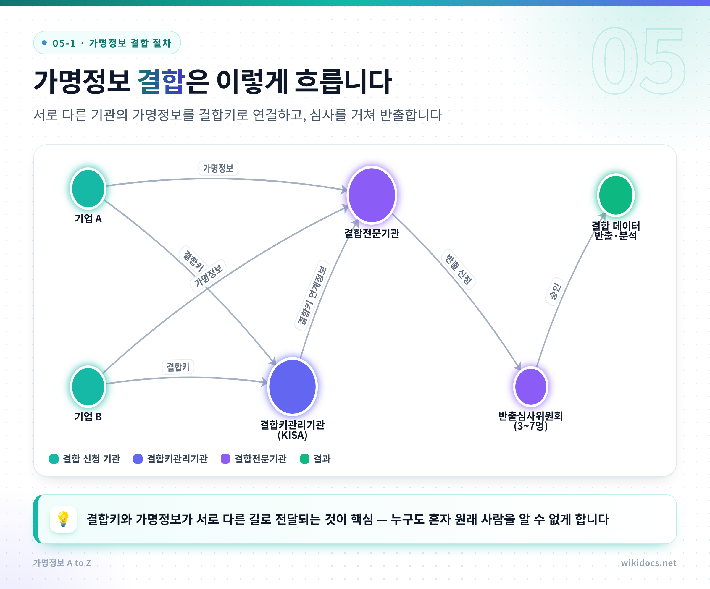
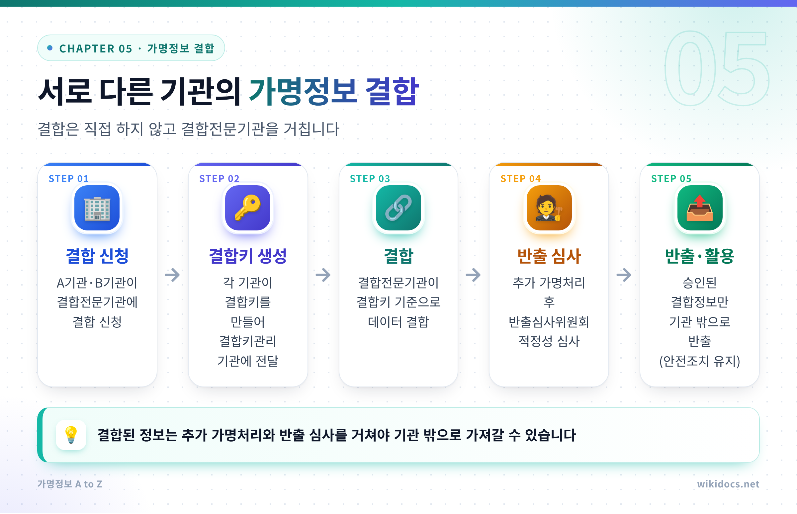

<!--
**상태**: 🔵 검토 중
**분류**: 05. 가명정보 결합
**태그**: #결합
**작성일**: 2026-11-22
-->
> 📅 **최종 확인**: 2026-11-22

카드사의 소비 데이터와 통신사의 이동 데이터를 합치면 "어느 지역에 어떤 상권이 필요한가"를 훨씬 정확히 알 수 있습니다. 이렇게 **서로 다른 기관의 가명정보를 합치는 것**을 가명정보 결합이라고 합니다. 결합은 데이터 활용의 가치를 크게 높이지만, 재식별 위험도 커지기 때문에 **법이 정한 절차**를 따라야 합니다.

[TOC]

## 요약

- 서로 다른 개인정보처리자 간의 결합은 **결합전문기관**만 수행할 수 있습니다. (개인정보 보호법 제28조의3)
- 같은 사람을 연결하는 **결합키**는 **결합키관리기관(한국인터넷진흥원)**만 다루고, 결합전문기관은 결합키 대신 **연계정보**만 받습니다.
- 결합된 정보를 밖으로 가져가려면 **추가 가명처리**와 **반출심사**를 거칩니다.



## 결합 절차 한눈에 보기



| 단계 | 누가 | 무엇을 |
|---|---|---|
| 1. 결합 신청 | 결합신청자(각 기관) | 결합전문기관에 결합 신청 |
| 2. 정보 생성·전송 | 결합신청자 | ① 일련번호 ② 결합키 ③ 가명정보를 만들어 **①② → 결합키관리기관**, **①③ → 결합전문기관**으로 나눠 전송 |
| 3. 연계정보 생성 | 결합키관리기관 (한국인터넷진흥원) | 같은 결합키를 가진 일련번호끼리 연결한 **결합키연계정보**를 만들어 결합전문기관에 전달 |
| 4. 결합 | 결합전문기관 | 연계정보로 가명정보를 결합 |
| 5. 추가 처리·반출 심사 | 결합신청자 → 결합전문기관 | 결합된 정보에 추가 가명처리 후 반출 심사 요청 |
| 6. 반출·파기 | 결합전문기관·결합키관리기관 | 승인된 정보 반출, 결합 과정의 불필요한 자료는 지체 없이 파기 |

[[TIP("핵심: 아무도 전체를 보지 않는다")]]

이 절차의 핵심은 **역할 분리**입니다. 결합키관리기관은 결합키만 보고 가명정보(속성)는 보지 않으며, 결합전문기관은 가명정보만 보고 결합키는 보지 않습니다. 결합신청자는 상대 기관의 원본을 보지 않습니다.

[[/TIP]]

## 예제: 결합 흐름 시뮬레이션

저장소의 `code/03_linkage.py`는 카드사(A)와 통신사(B)의 가상 고객 3명씩으로 결합 흐름을 단순화해 보여 줍니다.

```python
def prepare(org, data):
    """① 일련번호 ② 결합키 ③ 가명정보 → ①② 는 결합키관리기관, ①③ 은 결합전문기관으로"""
    for name, phone, birth, attrs in data:
        serial = f"{org}-{secrets.token_hex(3)}"
        to_kisa.append((serial, combine_key(name, phone, birth)))
        to_agency.append((serial, attrs))          # 이름·연락처 없이 속성만
```

**실행 결과** (일련번호는 실행할 때마다 달라집니다)

```text
결합키연계정보(일련번호 쌍): [('A-0bbd28', 'B-638fec'), ('A-06a372', 'B-161bea')]
결합 결과: [{'결합ID': 'C001', '월카드사용': 1520000, '월데이터GB': 12},
           {'결합ID': 'C002', '월카드사용': 640000, '월데이터GB': 35}]
A 3명, B 3명 → 양쪽에 모두 있는 2명만 결합 (이름·연락처는 전달되지 않음)
```

결합 결과에는 이름도 연락처도 결합키도 없습니다. **양쪽 모두에 있는 2명의 속성만** 새 결합ID로 묶였습니다.

> 이 예제는 원리를 설명하기 위한 단순화 모형입니다. 실제 결합키 생성 규칙, 전송 방식, 서식은 「가명정보의 결합 및 반출 등에 관한 고시」와 결합전문기관 안내를 따릅니다.

## 결합키를 만들 때 주의할 점

| 주의 | 이유 | 방법 |
|---|---|---|
| 같은 규칙 사용 | 기관마다 규칙이 다르면 같은 사람이 연결되지 않음 | 결합 전에 결합키 생성 항목·형식(예: 하이픈 제거)을 합의 |
| 입력값 정제 | "010-2345-6789"와 "01023456789"는 다른 키가 됨 | 공백·하이픈·대소문자 통일 |
| 결합률 확인 | 예상보다 결합률이 낮으면 규칙 불일치 의심 | 시범 결합으로 결합률 점검 |

## 실무 체크포인트

- [ ] 외부 기관과의 결합은 결합전문기관을 통해 신청하는가
- [ ] 결합키 생성 규칙과 입력값 형식을 사전에 합의했는가
- [ ] 결합키와 가명정보를 서로 다른 기관에 나눠 보내는가
- [ ] 반출 전에 추가 가명처리 계획을 세웠는가

## 근거·출처

| 구분 | 출처 | 비고 |
|---|---|---|
| 법령 | [개인정보 보호법 (국가법령정보센터)](https://www.law.go.kr/법령/개인정보보호법) | 제28조의3 |
| 고시 | [가명정보의 결합 및 반출 등에 관한 고시 의결 (전자신문, 2020.8.)](https://www.etnews.com/20200826000189) | 고시 제정 |
| 절차 | [결합소개 — 가명정보 결합이란 (개인정보보호위원회 결합지원)](https://link.privacy.go.kr/nadac/organ/introData.do) | 결합 절차 |
| 절차 | [가명정보 결합 절차·방법 법제화 (ZDNet Korea)](https://zdnet.co.kr/view/?no=20200826153751) | 역할 분리 |
| 해설 | [가명 데이터 결합, 어떻게 시작할 수 있나? (삼성SDS)](https://www.samsungsds.com/kr/insights/pseudonymization2.html) | 실무 해설 |

## 관련 페이지

- 05-2. 결합전문기관과 결합키관리기관
- 05-3. 결합 후 반출 심사
- 05-4. 가명정보 결합 선도사례로 보는 활용법
