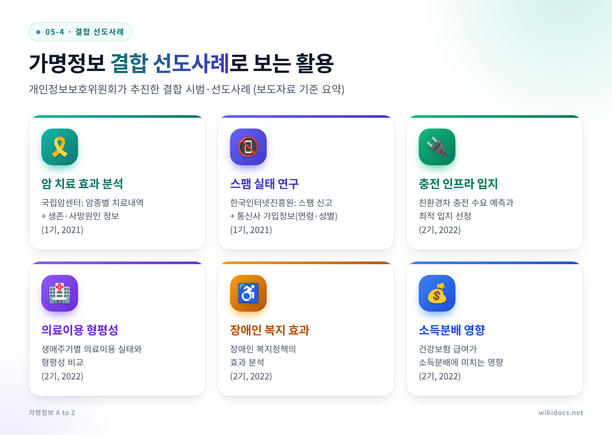

<!--
**상태**: 🔵 검토 중
**분류**: 05. 가명정보 결합
**태그**: #결합 #사례
**작성일**: 2026-11-22
-->
> 📅 **최종 확인**: 2026-11-22

개인정보보호위원회는 2021년부터 **가명정보 결합 시범·선도사례**를 선정해, 여러 기관의 데이터를 결합해 사회 문제를 분석하는 과제를 지원해 왔습니다. 이 사례들은 "결합으로 무엇을 알 수 있는가"를 보여 주는 가장 좋은 교재입니다.

## 요약

- **1기(2021)**: 의료·통신·레저 등 5대 분야, 31종 약 2,600만 건의 데이터를 가명처리·결합했습니다.
- **2기(2022)**: 소득분배, 의료이용 형평성, 장애인 복지, 친환경차 충전 인프라 등 4대 중점 과제에 17개 기관이 참여했습니다.
- 이후에도 기수별로 과제가 이어졌고(4기 교육·의료·물류 분야 등), 위원회는 완료된 과제의 **가명처리 내역 공개**를 추진했습니다.

## 대표 사례



| 기수 | 과제 | 결합한 데이터 (보도 기준) | 알 수 있게 된 것 |
|---|---|---|---|
| 1기 | 항암 치료 효과·사망위험 분석 | 국립암센터의 암종별 치료내역 + 생존·사망원인 정보 | 항암제 치료 효과와 사망 위험 요인 |
| 1기 | 스팸 실태 연구 | 한국인터넷진흥원 스팸 신고정보 + 통신사 가입정보(연령·성별 등) | 연령·성별에 따른 스팸 피해 실태, 예방 기반 |
| 2기 | 건강보험 급여의 소득분배 영향 | 건강보험·소득 관련 데이터 | 급여가 소득 격차를 얼마나 줄이는지 |
| 2기 | 생애주기별 의료이용 형평성 | 의료이용·인구 관련 데이터 | 계층·지역 간 의료이용 차이 |
| 2기 | 장애인 복지정책 효과 | 복지·인구 관련 데이터 | 정책의 실제 효과 |
| 2기 | 친환경차 충전 인프라 | 차량·이동 관련 데이터 | 충전 수요 예측과 최적 입지 |

> 결합한 데이터의 구체적 항목은 과제별 공개 자료에서 확인하세요. 표는 보도자료를 바탕으로 요약했습니다.

## 사례에서 배우는 결합 설계법

### 1. 하나의 기관으로는 답할 수 없는 질문에서 시작

```text
❓ "항암 치료가 생존에 실제로 도움이 되었나?"
   병원: 치료 기록은 있지만 → 퇴원 후 생존·사망 원인은 모름
   통계 기관: 사망 원인은 있지만 → 어떤 치료를 받았는지 모름
   ✅ 결합해야만 답할 수 있음 → 결합의 가치가 분명
```

### 2. 정책 질문과 연결

2기 과제는 모두 **정책 효과 분석**(소득분배, 형평성, 복지, 인프라)이었습니다. 공공의 이익이 분명한 질문은 참여 기관을 모으고 결합 필요성을 설명하기 쉽습니다.

### 3. 결과를 공개하고 재사용

위원회는 완료된 과제의 가명처리 내역을 공개해, **다른 기관이 비슷한 결합을 할 때 참고**하도록 했습니다. 우리 기관의 결합도 처리 내역을 잘 기록해 두면 다음 과제의 시간을 크게 줄일 수 있습니다.

[[TIP("요령: 선도사례 공모 활용")]]

개인정보보호위원회는 매년 결합 선도사례 수요조사와 공모를 진행합니다(2026년에도 제6기 수요조사 진행). 선정되면 결합 비용과 컨설팅을 지원받을 수 있으므로, **처음 결합을 시도하는 기관**이라면 공모를 먼저 확인해 보세요.

[[/TIP]]

## 실무 체크포인트

- [ ] 단일 기관 데이터로는 답할 수 없는 질문인지 확인했는가
- [ ] 결합의 공익성·정책 연관성을 설명할 수 있는가
- [ ] 비슷한 선도사례의 공개 자료를 참고했는가
- [ ] 선도사례 공모·지원 제도를 확인했는가

## 근거·출처

| 구분 | 출처 | 비고 |
|---|---|---|
| 보도 | [개인정보위, 제2기 가명정보 결합 선도사례 중점 추진 (정책브리핑)](https://www.korea.kr/news/policyNewsView.do?newsId=148899127) | 1기 성과, 2기 과제 |
| 보도 | [가명정보 결합 시범사례 선정 (아주경제, 2020.11.)](https://www.ajunews.com/view/20201130154606010) | 1기 과제 |
| 보도 | [가명정보 결합해 친환경차 충전 인프라 수요 예측 (ZDNet Korea)](https://zdnet.co.kr/view/?no=20220217210454) | 2기 과제 |
| 보도 | [제4기 가명정보 결합 선도사례 확정 (이투데이)](https://www.etoday.co.kr/news/view/2432924) | 4기 과제 |
| 보도 | [제6기 가명정보 결합 선도사례 수요 조사 (머니투데이, 2026.3.)](https://www.mt.co.kr/tech/2026/03/16/2026031610592147289) | 최신 공모 |
| 계획 | [2기 가명정보 결합 선도사례 추진계획 (국가전략정보포털)](https://nsp.nanet.go.kr/plan/subject/detail.do?nationalPlanControlNo=PLAN0000035692) | 참여 기관 |

## 관련 페이지

- 05-1. 결합 절차 개요
- 05-5. 금융 분야 결합
- 📚 07-4. 사례에서 배우는 활용 증진 전략
