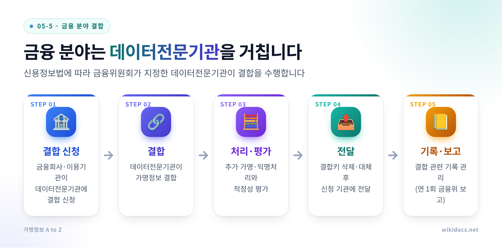

<!--
**상태**: 🔵 검토 중
**분류**: 05. 가명정보 결합
**태그**: #결합 #금융
**작성일**: 2026-11-22
-->
> 📅 **최종 확인**: 2026-11-22

금융회사의 신용정보를 결합할 때는 개인정보 보호법이 아니라 **신용정보법**의 절차를 따르며, 금융위원회가 지정한 **데이터전문기관**이 결합을 맡습니다. 카드·보험·은행 데이터는 활용 가치가 커서 결합 수요가 많은 분야입니다.

## 요약

- 2020년 8월 개정 신용정보법 시행 직후 금융위원회가 **신용정보원·금융보안원**을 데이터전문기관으로 처음 지정했습니다.
- 이후 추가 지정되어 2021년 금융위원회 발표 기준 **4곳**이 운영되었습니다.
- 결합 후 **결합키는 삭제하거나 대체키로 전환**하고, 결합 관련 기록은 **연 1회 금융위원회에 보고**합니다.

## 금융 분야 결합 흐름



## 일반 분야와 비교

| 구분 | 일반 분야 (개인정보 보호법) | 금융 분야 (신용정보법) |
|---|---|---|
| 결합 기관 | 결합전문기관 | 데이터전문기관 |
| 지정 | 개인정보보호위원회·관계 중앙행정기관 | 금융위원회 |
| 결합키 | 결합키관리기관(한국인터넷진흥원)이 연계정보 생성 | 결합 후 결합키 삭제 또는 대체키 전환 |
| 기록·보고 | 처리 기록 작성·보관 | 결합 관련 기록 관리, 연 1회 금융위 보고 |
| 안내서 | 가명정보 처리 가이드라인 | 금융분야 가명·익명처리 안내서 |

## 제도 개선 흐름

금융위원회는 결합 활성화를 위해 2021년 다음과 같은 개선을 추진했습니다.

| 개선 | 의미 |
|---|---|
| 데이터전문기관 추가 지정 방안 | 결합 수요 분산, 선택지 확대 |
| 데이터 자가결합 허용 요건 확대 | 일정 요건에서 자체 결합 가능성 확대 |
| 샘플링 결합 절차 도입 | 본 결합 전 표본으로 결합 가능성·결합률 확인 |
| 데이터 이용기관의 결합 신청 허용 | 데이터를 쓰려는 기관도 신청 가능 |

## 예시: 카드 + 보험 결합으로 소비·건강 연관 분석 (가상 시나리오)

```text
목적: 연령대·지역별 건강 관련 소비(운동·건강식품)와 보험 청구 경향의 관계 연구 (과학적 연구)

1. 카드사·보험사가 각각 가명처리 (이름·연락처 삭제, 연령→연령대, 주소→시군구)
2. 데이터전문기관에 결합 신청, 먼저 샘플링 결합으로 결합률 확인
3. 본 결합 → 결합키 삭제·대체
4. 추가 가명처리(소수 셀 처리) 후 적정성 평가
5. 연구기관에 전달, 결합 기록 관리
```

> 위 시나리오는 이해를 돕기 위한 가상 예시입니다. 보험 청구 정보에는 건강 관련 민감정보가 포함될 수 있으므로 보건의료 관련 기준도 함께 검토해야 합니다. (02-3)

[[TIP("요령: 샘플링 결합부터")]]

본 결합은 시간과 비용이 듭니다. **샘플링 결합으로 결합률과 분석 가능성을 먼저 확인**하면, 결합키 규칙 불일치나 표본 부족 같은 문제를 일찍 발견할 수 있습니다.

[[/TIP]]

## 실무 체크포인트

- [ ] 신용정보에 해당하는 데이터인지 확인했는가
- [ ] 데이터전문기관 절차와 금융분야 안내서를 확인했는가
- [ ] 샘플링 결합으로 결합률을 먼저 점검했는가
- [ ] 민감정보가 섞인다면 해당 분야 기준을 함께 검토했는가

## 근거·출처

| 구분 | 출처 | 비고 |
|---|---|---|
| 보도 | [금융 데이터전문기관 신용정보원·금융보안원 지정 (바이라인네트워크, 2020.8.)](https://byline.network/2020/08/9-67/) | 최초 지정 |
| 금융위 | [금융위원회 보도자료: 데이터 결합 제도 개선](https://www.fsc.go.kr/no010101/75973) | 4곳 운영, 개선 과제 |
| 금융위 | [금융위원회 보도자료: 신용정보법 시행령 개정](https://www.fsc.go.kr/po010106/77193) | 결합키 처리, 연 1회 보고 |

## 관련 페이지

- 05-1. 결합 절차 개요
- 📚 02-3. 분야별 가이드라인
- 📚 07-2. 금융 분야 사례
