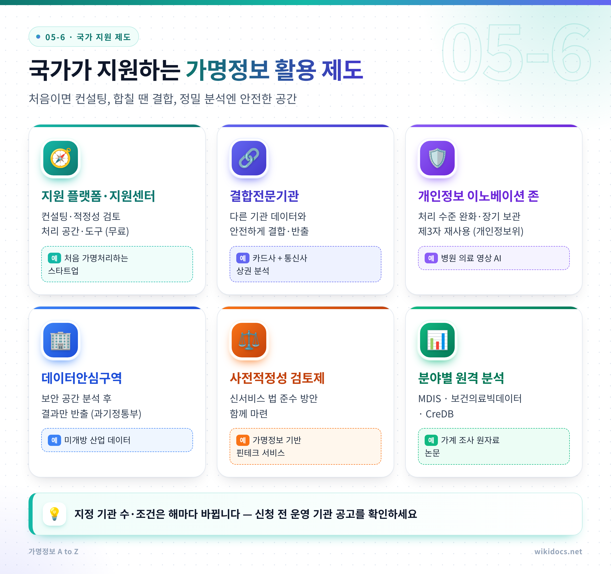

<!--
**상태**: 🔵 검토 중
**분류**: 05. 가명정보 결합
**태그**: #결합 #지원제도 #안심구역
**작성일**: 2026-11-24
-->
> 📅 **최종 확인**: 2026-11-24

가명정보를 써 보고 싶어도 "처리 방법을 모르겠다", "분석할 안전한 공간이 없다", "다른 기관 데이터와 합치기 어렵다"는 이유로 멈추는 경우가 많습니다. 정부는 이런 어려움을 덜기 위해 **컨설팅, 안전한 분석 공간, 결합, 법적 사전 검토, 공공 데이터 개방**을 지원하는 여러 제도를 운영합니다. 이 페이지에서는 제도별로 무엇을 지원하고 누가 쓰면 좋은지 정리합니다.

## 요약

- 가명처리가 처음이면 **가명정보 지원 플랫폼과 지역 가명정보 활용 지원센터**의 컨설팅부터 받습니다.
- 정밀한 분석이나 장기 연구에는 **개인정보 이노베이션 존**(개인정보보호위원회)이나 **데이터안심구역**(과학기술정보통신부) 같은 안전한 분석 공간을 씁니다.
- 새 서비스의 법적 불확실성은 **사전적정성 검토제**로, 공공 통계·보건의료·금융 데이터는 **분야별 원격 분석 시스템**으로 해결합니다.



## 제도 한눈에 보기

| 제도 | 운영 | 이런 분께 | 핵심 지원 |
|---|---|---|---|
| 가명정보 지원 플랫폼·지역 활용 지원센터 | 개인정보보호위원회·KISA | 가명처리가 처음인 중소기업·스타트업·공공기관 | 교육, 컨설팅, 적정성 검토, 처리 공간과 도구 |
| 가명정보 결합전문기관 | 개인정보보호위원회·관계 부처 지정 | 다른 기관 데이터와 합쳐야 하는 기관 | 안전한 결합과 반출 심사 (05-1~05-5) |
| 개인정보 이노베이션 존 | 개인정보보호위원회 지정 | 가명정보를 더 정밀하게·오래 써야 하는 연구 | 처리 수준 완화, 결합키 활용, 장기 보관, 제3자 재사용 |
| 데이터안심구역 | 과학기술정보통신부 지정 | 공개되지 않은 데이터를 분석하려는 기업·연구자 | 보안 공간에서 분석하고 결과만 반출 |
| 사전적정성 검토제 | 개인정보보호위원회 | 신기술·신서비스를 개발하는 사업자 | 법 준수 방안을 함께 마련 |
| 분야별 원격 분석 시스템 | 국가데이터처·건강보험심사평가원·한국신용정보원 등 | 통계·보건의료·금융 연구자 | 원자료는 두고 분석 결과만 반출 |

> 지정 기관 수와 지원 조건은 해마다 바뀝니다. 아래 내용은 2026년 11월까지 확인한 공개 자료 기준이며, 신청 전에 운영 기관의 공고를 확인하세요.

## 1. 가명정보 지원 플랫폼과 지역 가명정보 활용 지원센터

**가명정보 지원 플랫폼**(dataprivacy.go.kr)은 KISA가 운영합니다. 가명·익명처리에 어려움이 있는 중소기업·스타트업·공공기관에 **교육, 컨설팅, 인프라, 결합 지원**을 묶어 기술지원을 제공합니다.

지역의 **가명정보 활용 지원센터**는 공고 기준으로 다음을 **무료로** 지원합니다.

| 지원 | 내용 |
|---|---|
| 컨설팅·적정성 검토 | 가명처리 계획 수립, 위험도 분석, 적정성 검토, 심의위원회 운영 |
| 처리 공간 | 폐쇄망으로 분리된 처리 공간과 보안 설비 |
| 도구 | 비식별 솔루션, 분석·시각화 도구(Python, R 등) |
| 실습 | 기관이 가진 개인정보를 반입해 가명처리·결합·탐색적 분석(EDA) 수행 |
| 교육 | 제도 교육, 세미나, 실습 교육 |

신청은 플랫폼에 회원가입한 뒤 지역 센터를 예약하는 방식입니다. 센터마다 특화 분야와 일정이 다르므로 공고를 확인합니다. 개인정보보호위원회가 공개한 **합성데이터 참조모델** 데이터도 이 플랫폼에서 내려받을 수 있습니다(04-8).

## 2. 개인정보 이노베이션 존

다중 인증, 실시간 화면 녹화 같은 강화된 보안 체계를 갖춘 **데이터 안심 공간**입니다. 처리 환경 자체가 안전하므로, 일반 연구 공간에서는 어려운 일을 할 수 있습니다.

- 가명처리 수준을 **완화**해 더 정밀한 분석
- **결합키** 활용
- 가명정보 **장기 보관**
- 가명정보의 **제3자 재사용**

| 시기 | 지정 경과 (공개 보도 기준) |
|---|---|
| 2023년 12월 | 통계청·국립암센터를 시범운영기관으로 지정 (당시 명칭 '개인정보 안심구역') |
| 2024년 7월 | 한국도로공사·한국사회보장정보원·더존비즈온 추가 지정 |
| 2025년 10월 | 광주테크노파크·한국교육학술정보원 추가 (운영기관 7개) |
| 2026년 4월 | 대구디지털혁신진흥원 추가 (8개) |
| 2026년 9월 | 국세청·질병관리청 추가 (10개) |

공모는 국비지원 부문과 자체구축 부문으로 나뉘며, 이노베이션 존에서는 프라이버시 강화 기술(PET) 실증연구도 할 수 있다고 안내됩니다.

## 3. 데이터안심구역 (과학기술정보통신부)

「데이터 산업진흥 및 이용촉진에 관한 기본법」(데이터산업법) 제11조에 근거한 제도입니다. 공개하기 어려운 데이터를 **보안이 갖춰진 공간에서 분석**하고 결과만 가져가도록 합니다. '데이터안심구역 지정 및 운영에 관한 지침'과 보안대책 기준을 충족한 기관이 지정됩니다.

- 2025년 5월 건양대학교병원, 경북대학교 첨단정보통신융합산업기술원, 기술보증기금, 한국도로공사 4곳이 추가되어 **총 14곳**이 되었다고 발표되었습니다.
- 2026년에는 일반지정·전환지정 공모가 진행되었습니다.

[[TIP("헷갈리기 쉬운 두 제도")]]

**개인정보 이노베이션 존**은 개인정보보호위원회가 개인정보 보호법 체계에서 운영하고, **데이터안심구역**은 과학기술정보통신부가 데이터산업법에 따라 운영합니다. 둘 다 "안전한 공간에서 분석하고 결과만 가져간다"는 생각은 같지만, **운영 부처·근거 법령·지정 기관이 다른 별개 제도**입니다. 이용하려는 데이터가 어느 기관에 있는지부터 확인하세요.

[[/TIP]]

## 4. 사전적정성 검토제

AI 등 신기술·신서비스를 **기획·개발하는 단계**에서, 사업자와 개인정보보호위원회가 함께 개인정보 보호법 준수 방안을 마련하는 제도입니다.

```text
신청 → 요건 검토 → 현황 분석 → 적용 방안 마련 → 위원회 심의·의결 → 의견서 통보 → 이행 점검
```

개인정보보호위원회는 '적정'으로 회신한 내용대로 이행한 행위에 대해서는 **사후 행정처분을 하지 않는다**고 안내합니다. 2023년 10월 시범 운영을 시작했고, 2024년 3월 운영규정 고시가 제정되었습니다. 가명정보를 활용하는 새 서비스를 출시하기 전, 처리 방식이 적법한지 확신이 서지 않을 때 쓸 수 있습니다.

## 5. 분야별 원격 분석 시스템

이미 공공기관이 가진 데이터를 연구에 쓰는 길도 있습니다. 공통점은 **원자료는 밖으로 나가지 않고, 심사를 거친 분석 결과만 반출**한다는 것입니다.

| 분야 | 시스템 | 이용 방식 |
|---|---|---|
| 국가통계 | 마이크로데이터 통합서비스(MDIS) | 공공용 자료는 내려받기. 민감 항목이 있는 인가용 자료는 이용센터(RDC)나 원격접근(RAS)에서만 분석하고 결과는 심사 후 반출. SAS·SPSS·Stata·R 제공 |
| 보건의료 | 건강보험심사평가원 보건의료빅데이터개방시스템 | 공개 데이터와 분석 서비스(이용료 있음). 보건의료 데이터 활용 가이드라인 함께 확인(02-3) |
| 금융 | 한국신용정보원 CreDB | 비식별 신용정보를 원격분석시스템에서 분석, DB 자체 반출은 금지 |
| 공공 | 공공데이터포털 | 공개 데이터 내려받기·API |

## 예시: 상황별로 고르기

| 상황 (가상) | 추천 제도 |
|---|---|
| 직원 30명 스타트업이 고객 데이터로 첫 통계 분석을 하려 함 | 지역 가명정보 활용 지원센터 컨설팅 → 적정성 검토 |
| 카드사와 통신사가 데이터를 합쳐 상권 분석을 하려 함 | 결합전문기관을 통한 가명결합 (05-1) |
| 병원이 의료 영상으로 AI를 학습시키되 처리 수준을 낮추고 싶음 | 개인정보 이노베이션 존 |
| 대학원생이 가계 조사 원자료로 논문을 씀 | MDIS 원격접근 |
| 핀테크가 가명정보 기반 신규 서비스를 출시하려 함 | 사전적정성 검토제 |

## 실무 체크포인트

- [ ] 우리 상황(처음인지, 결합인지, 정밀 분석인지)에 맞는 제도를 골랐는가
- [ ] 신청 전 운영 기관의 최신 공고(조건·일정)를 확인했는가
- [ ] 안전한 분석 공간을 쓰더라도 처리 기록과 반출 심사 절차를 지켰는가
- [ ] 이노베이션 존과 데이터안심구역의 차이를 확인했는가

## 근거·출처

| 구분 | 출처 | 비고 |
|---|---|---|
| 공식 | [가명정보 지원 플랫폼 (KISA)](https://dataprivacy.go.kr) | 지원 서비스, 결합전문기관 목록 |
| 공고 | 부산 가명정보 활용 지원센터 컨설팅 지원 모집공고 | 무료 지원 범위, 신청 절차 |
| 공식 | [국립암센터·통계청 개인정보 안심구역 지정 (개인정보보호위원회)](https://pipc.go.kr/np/cop/bbs/selectBoardArticle.do?bbsId=BS074&mCode=C020010000&nttId=9802) | 2023.12 시범 지정 |
| 보도 | [개인정보 안심구역 3곳 추가 지정 (보안뉴스)](http://www.boannews.com/news/articleView.html?idxno=131032) | 2024.7 |
| 공식 | [개인정보 이노베이션 존 2개 기관 추가 지정 (정책브리핑)](https://www.korea.kr/briefing/pressReleaseView.do?newsId=156734039) | 2025.10, 7개 기관 |
| 보도 | [이노베이션 존 국세청·질병청 추가 지정 (네이트뉴스)](https://m.news.nate.com/view/20260921n09047) | 2026.9, 10개 기관 |
| 공식 | [데이터안심구역 4개 신규 지정 (정책브리핑)](https://www.korea.kr/news/policyNewsView.do?newsId=148942957) | 2025.5, 총 14곳 |
| 보도 | [과기정통부 데이터안심구역 신규 지정 공모 (아시아에이)](https://www.asiaa.co.kr/news/articleView.html?idxno=241750) | 2026 일반·전환지정 |
| 공식 | [사전적정성 검토제 안내 (개인정보보호위원회)](https://pipc.go.kr/np/default/page.do?mCode=I020010000) | 절차, 사후 처분 면제 |
| 보도 | [사전적정성 검토제 운영규정 고시 제정 (보안뉴스)](https://m.boannews.com/html/detail.html?idx=128281) | 2024.3 |
| 공식 | [MDIS 이용 안내](https://mdis.kostat.go.kr/data/MDIS_introduction.pdf) | 공공용·인가용, RDC·RAS |
| 공식 | [보건의료빅데이터개방시스템 (건강보험심사평가원)](https://opendata.hira.or.kr) | 보건의료 데이터 |
| 공식 | [금융분야 빅데이터 인프라 (금융위원회)](https://fsc.go.kr/no010101/73721) | CreDB 원격분석 |

## 관련 페이지

- 05-1. 결합 절차 개요
- 05-2. 결합전문기관과 결합키관리기관
- 📚 07-5. 가명정보로 연구하는 방법
- 📚 04-8. 프라이버시 강화 기술 (합성데이터)
