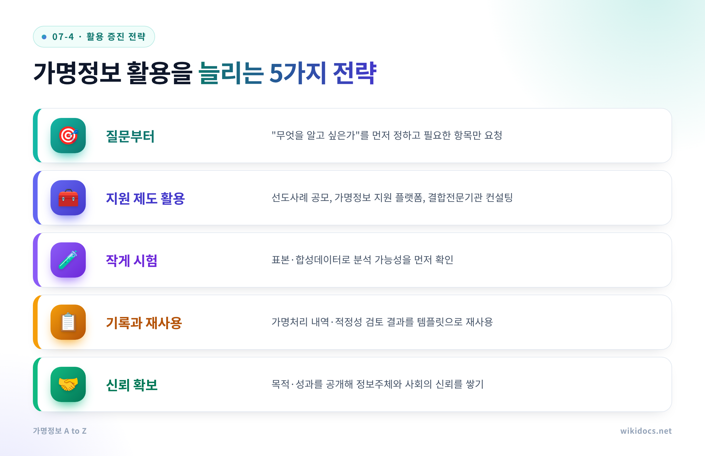

<!--
**상태**: 🔵 검토 중
**분류**: 07. 활용 사례
**태그**: #사례 #전략
**작성일**: 2026-11-22
-->
> 📅 **최종 확인**: 2026-11-22

가명정보 제도는 도입되었지만 "절차가 복잡하다", "어디서부터 해야 할지 모르겠다"는 이유로 활용을 망설이는 기관이 많습니다. 이 페이지는 국내외 사례와 지원 제도에서 찾은 **활용을 늘리는 실천 전략**을 정리합니다.

## 요약

- **질문부터**: 결합·처리 범위는 질문이 정합니다.
- **지원 제도 활용**: 선도사례 공모, 가명정보 지원 플랫폼, 우수사례집, 결합전문기관 상담
- **작게 시험 → 기록 → 재사용**: 표본·합성데이터로 먼저 확인하고, 처리 내역을 템플릿으로 남깁니다.

## 5가지 전략

| 전략 | 구체적으로 | 근거·참고 |
|---|---|---|
| 1. 질문부터 | 한 기관으로는 답할 수 없는 질문, 정책·사업과 연결된 질문 | 05-4 선도사례 |
| 2. 지원 제도 활용 | 결합 선도사례 공모(매년), 가명정보 지원 플랫폼, 우수사례집 | 개인정보보호위원회·한국인터넷진흥원 |
| 3. 작게 시험 | 샘플링 결합(금융), 합성데이터로 분석 가능성 확인 | 05-5, 04-8 |
| 4. 기록과 재사용 | 가명처리 내역, 적정성 검토 결과, 결합키 규칙을 문서 템플릿으로 | 선도사례 가명처리 내역 공개 |
| 5. 신뢰 확보 | 활용 목적과 성과를 공개, 재식별 금지 서약·교육 | 02-4 |

## 흔한 장애물과 해결

| 장애물 | 해결 방법 |
|---|---|
| "절차가 복잡해 엄두가 안 난다" | 가이드라인의 5단계를 내부 템플릿(서식)으로 만들어 재사용 |
| "결합 상대 기관을 못 찾겠다" | 선도사례 공모·수요조사에 참여해 매칭 기회 활용 |
| "결합률이 너무 낮게 나왔다" | 결합키 생성 규칙·입력값 형식을 사전에 맞추고 샘플링 결합으로 점검 |
| "반출 심사에서 정보가 너무 줄었다" | 통계표 반출, 결합전문기관 분석 공간 이용 검토 |
| "법적으로 괜찮은지 불안하다" | 목적·처리·검토 기록을 남기고, 필요하면 전문가 자문 |

## 해외에서 배우는 점

| 나라 | 시사점 | 자세히 |
|---|---|---|
| EU | 가명처리를 "위험을 줄이는 수단"으로 보고 다른 안전조치와 함께 평가 | 09-1 |
| EU 판례 | 받는 쪽에서 재식별할 수단이 없다면 그쪽에게는 개인정보가 아닐 수 있다는 판단 → 제공 시 수단 통제가 중요 | 09-2 |
| 영국 | 식별 위험을 상황(누가, 어떤 수단으로) 기준으로 판단 | 09-3 |
| 미국 | 정해진 18개 식별자 삭제(Safe Harbor) 또는 전문가 판단 두 가지 경로 | 09-4 |
| 일본 | 내부 활용 중심의 가명가공정보로 절차 부담 완화 | 09-5 |

[[TIP("한 문장 정리")]]

가명정보 활용을 늘리는 가장 빠른 길은 **"좋은 질문 하나 + 작은 시범 + 잘 남긴 기록"**입니다. 첫 과제의 기록이 두 번째 과제의 시간을 절반으로 줄입니다.

[[/TIP]]

## 실무 체크포인트

- [ ] 올해 시도할 가명정보 활용 질문 1~3개를 정했는가
- [ ] 선도사례 공모·우수사례집 등 지원 제도를 확인했는가
- [ ] 가명처리 절차를 재사용 가능한 템플릿으로 만들었는가
- [ ] 활용 성과를 공개해 신뢰를 쌓을 계획이 있는가

## 근거·출처

| 구분 | 출처 | 비고 |
|---|---|---|
| 지원 | [가명정보 지원 플랫폼 우수사례](https://dataprivacy.go.kr/bestAndContest/bestPractices/selectBestPracticesList.do) | 우수사례·경진대회 |
| 사례집 | [가명정보 활용 우수사례집 (한국인터넷진흥원, 공공데이터포털)](https://www.data.go.kr/data/15133318/fileData.do?recommendDataYn=Y) | 수상작·주요 사례 |
| 사례집 | [가명정보 활용 우수사례집 (개인정보보호위원회 자료실)](https://pipc.go.kr/np/cop/bbs/selectBoardArticle.do?bbsId=BS217&mCode=G010030020&nttId=12504) | 경진대회 수상작 |
| 공모 | [제6기 가명정보 결합 선도사례 수요 조사 (머니투데이)](https://www.mt.co.kr/tech/2026/03/16/2026031610592147289) | 공모 일정 |

## 관련 페이지

- 07-1. 보건의료 분야 사례
- 📚 05-4. 가명정보 결합 선도사례로 보는 활용법
- 📚 09-6. 국가별 비교와 우리에게 주는 시사점
