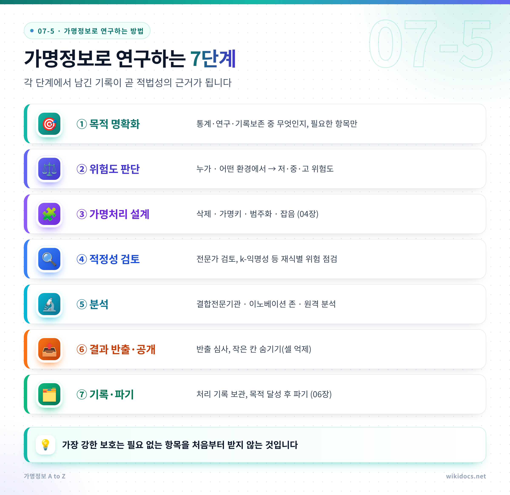

<!--
**상태**: 🔵 검토 중
**분류**: 07. 활용 사례
**태그**: #사례 #연구 #절차
**작성일**: 2026-11-24
-->
> 📅 **최종 확인**: 2026-11-24

앞의 사례들이 "무엇을 했는가"였다면, 이 페이지는 **"내가 가명정보로 연구하려면 어떻게 시작하는가"**를 다룹니다. 연구 질문을 세우는 단계부터 결과를 공개하는 단계까지, 어떤 경로와 절차를 거치는지 예시와 함께 정리합니다.

## 요약

- 먼저 **연구 경로**를 고릅니다: 우리 데이터만 쓰는지, 다른 기관 데이터와 결합하는지, 안전한 분석 공간이 필요한지, 공공 데이터를 쓰는지.
- 절차는 **목적 → 위험도 판단 → 가명처리 설계 → 적정성 검토 → 분석 → 결과 반출 → 기록·파기** 7단계입니다.
- 2026년 개정 가이드라인의 **저·중·고 위험도** 체계에 따라, 누가 어떤 환경에서 쓰는지가 처리 수준을 정합니다(02-2).



## 1. 연구 경로 고르기

| 나의 상황 | 추천 경로 | 참고 |
|---|---|---|
| 우리 기관 데이터만 분석, 경험이 적음 | 지역 가명정보 활용 지원센터의 컨설팅·적정성 검토를 받고 처리 | 05-6 |
| 다른 기관 데이터와 합쳐야 함 | 결합전문기관(금융은 데이터전문기관)을 통한 가명결합 | 05-1, 05-5 |
| 처리 수준을 낮춰 정밀하게 분석, 장기 연구 | 개인정보 이노베이션 존 또는 데이터안심구역 | 05-6 |
| 국가통계·건강보험·신용정보 등 공공 데이터 | MDIS·보건의료빅데이터개방시스템·CreDB 원격 분석 | 05-6 |
| AI 학습용, 결과 데이터를 공개 배포해야 함 | 합성데이터 생성과 안전성 검증 | 04-8 |
| 새 서비스 출시 전 법적 불확실성 | 사전적정성 검토제 | 05-6 |

## 2. 연구 절차 7단계

| 단계 | 할 일 | 남길 기록 |
|---|---|---|
| ① 목적 명확화 | 통계 작성·과학적 연구·공익적 기록보존 중 무엇인지, 연구 질문과 **꼭 필요한 항목**만 정함 | 연구 계획서, 항목 목록 |
| ② 위험도 판단 | 활용 주체와 처리 환경을 따져 저·중·고 위험도 결정 | 위험도 판단 근거 |
| ③ 가명처리 설계 | 식별자는 삭제·가명키, 준식별자는 범주화, 희소값은 잡음·삭제 (04장) | 항목별 처리 내역 |
| ④ 적정성 검토 | 내부 또는 외부 전문가 검토, k-익명성 등 재식별 위험 점검 | 적정성 검토 결과서 |
| ⑤ 분석 | 결합이 필요하면 결합전문기관, 정밀 분석은 안전한 분석 공간 | 분석 환경·접근 기록 |
| ⑥ 결과 반출·공개 | 반출 심사, 작은 집단이 드러나지 않게 **셀 억제**(작은 칸 숨기기) | 반출 심사 결과 |
| ⑦ 기록·파기 | 처리 기록 보관, 목적 달성 후 파기 (06장) | 처리·파기 기록 |

[[TIP("가장 강한 보호는 '처음부터 받지 않는 것'")]]

연구에 쓰지 않을 항목은 처음부터 요청하지 마세요. 항목이 줄면 위험도가 낮아지고, 가명처리와 적정성 검토도 쉬워집니다. "혹시 몰라서" 받은 항목이 재식별 위험의 가장 흔한 원인입니다.

[[/TIP]]

## 3. 연구 예시 (가상)

### 예시 A: 지역 소비와 건강 (가명결합)

```text
[연구 질문] 편의점 야간 결제 비율과 지역 만성질환 유병률은 관계가 있는가?
[데이터]   카드사 결제 가명정보 + 지역 보건 통계
[경로]     결합전문기관을 통한 가명결합
[흐름]
  카드사: 결합키 → 결합키관리기관 / 가명정보 → 결합전문기관
  결합전문기관: 결합 → 반출심사위원회 승인
  반출: 시군구 단위 집계 결과만 (개인 단위 레코드 반출 안 함)
```

### 예시 B: 의료 영상 AI (이노베이션 존)

```text
[연구 질문] 흉부 X선으로 폐렴을 조기에 찾는 AI를 만들 수 있는가?
[경로]     개인정보 이노베이션 존 (처리 수준 완화, 장기 보관)
[가명처리] 영상 위 이름·날짜 표시 삭제, 판독문의 이름·병원명 대체,
           대량 영상은 표본 검수 — 표본 크기와 선택 방법을 기록 (02-2)
[결과]     학습된 모델과 성능 지표만 반출
```

### 예시 C: 가계 조사 원자료 논문 (원격 분석)

```text
[연구 질문] 1인 가구의 소득 구간별 주거비 부담은 어떻게 다른가?
[경로]     MDIS 원격접근 서비스 (인가용 자료)
[분석]     원격 환경에서 회귀분석 수행
[결과]     회귀분석 결과표만 심사를 거쳐 반출 → 논문 게재
```

## 4. 결과를 공개할 때 주의할 점

| 위험 | 예 | 대처 |
|---|---|---|
| 작은 집단 노출 | "○○군 80대 희귀질환자 2명" | 기준 미만의 칸은 숨기거나 상위 범주로 합침 |
| 차분 공격 | 같은 표를 조건만 바꿔 여러 번 공개 | 공개 표 사이의 차이로 개인이 드러나지 않는지 확인 |
| 모델을 통한 노출 | AI 모델이 학습 데이터를 기억해 출력 | 학습 데이터 기억 여부 점검 (08-1) |

## 연구 계획서 체크리스트

- [ ] 목적(통계·연구·기록보존)과 연구 질문이 분명한가
- [ ] 꼭 필요한 항목만 요청했는가
- [ ] 위험도(저·중·고)와 그 근거를 적었는가
- [ ] 가명처리 방법과 재식별 위험 점검 방법을 적었는가
- [ ] 결합·분석 경로(결합전문기관, 이노베이션 존, 원격 분석 등)를 정했는가
- [ ] 결과 반출 기준과 공개 방식(셀 억제 등)을 정했는가
- [ ] 기록 보관과 파기 계획이 있는가

## 근거·출처

| 구분 | 출처 | 비고 |
|---|---|---|
| 법령 | [개인정보 보호법 (국가법령정보센터)](https://www.law.go.kr/법령/개인정보보호법) | 제28조의2~제28조의7 |
| 공식 | ['가명정보 가이드라인' 전면 개정 (정책브리핑, 2026.3.)](https://www.korea.kr/news/policyNewsView.do?newsId=148961790) | 위험도 기반 체계 |
| 해설 | [가명정보 가이드라인 전면 개정 (법무법인 화우)](https://www.hwawoo.com/kor/insights/newsletter/14688) | 표본 검수와 기록 |
| 공식 | [MDIS 이용 안내](https://mdis.kostat.go.kr/data/MDIS_introduction.pdf) | 원격접근 절차 |
| 공식 | [가명정보 지원 플랫폼 (KISA)](https://dataprivacy.go.kr) | 지원센터·결합 |

## 관련 페이지

- 07-4. 사례에서 배우는 활용 증진 전략
- 📚 05-6. 국가가 지원하는 가명정보 활용 제도
- 📚 03장 가명처리 절차
- 📚 06장 안전조치와 사후관리
