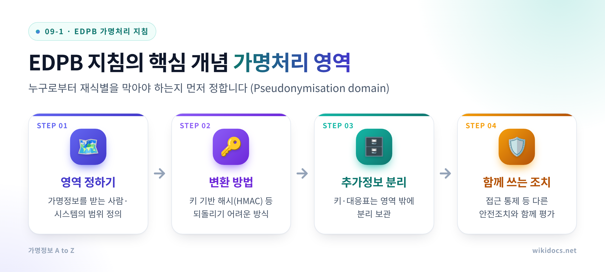

<!--
**상태**: 🔵 검토 중
**분류**: 09. 해외 제도와 사례
**태그**: #해외 #EU
**작성일**: 2026-11-22
-->
> 📅 **최종 확인**: 2026-11-22

EU의 일반개인정보보호규정(GDPR)은 가명처리(Pseudonymisation)를 정의하고 여러 조항에서 권장하는, 우리 제도의 중요한 참고 모델입니다. 2025년 1월에는 유럽개인정보보호이사회(EDPB)가 **가명처리 지침(Guidelines 01/2025)**을 의견수렴용으로 채택해 실무 기준을 구체화했습니다.

[TOC]

## 요약

- GDPR에서 **가명처리한 데이터도 개인정보**입니다. 추가정보로 다시 개인과 연결할 수 있기 때문입니다.
- 가명처리는 GDPR의 여러 의무(설계 단계의 보호, 보안, 연구 목적 처리)를 충족하는 **위험 감소 수단**으로 권장됩니다.
- EDPB 지침은 **"가명처리 영역(Pseudonymisation domain)"** 개념, 키 관리, 일방향 함수 사용 등을 안내합니다.

## GDPR의 가명처리 관련 조항

| 조항 | 내용 (요약) | 우리 제도와 비교 |
|---|---|---|
| 제4조 제5호 | 가명처리 정의: 추가정보 없이는 특정 개인에게 귀속될 수 없도록 처리, 추가정보는 분리 보관하고 기술적·관리적 조치 적용 | 개인정보 보호법 제2조 제1호의2와 유사 |
| 전문 제26항 | 가명처리한 개인정보는 여전히 개인정보, 익명정보에는 GDPR 미적용 | 가명정보=개인정보, 익명정보 적용 제외 (제58조의2) |
| 전문 제28항 | 가명처리는 정보주체의 위험을 줄이고 의무 이행을 도움 | — |
| 제6조 제4항 (e) | 목적 외 처리의 양립 가능성 판단 시 가명처리 등 안전조치 고려 | 우리는 목적(통계·연구·기록보존)을 법에서 정함 |
| 제25조 | 설계 및 기본설정에 의한 데이터 보호 수단의 예로 가명처리 | — |
| 제32조 | 처리 보안 조치의 예로 가명처리·암호화 | 안전조치 의무 (제28조의4) |
| 제89조 | 과학적·역사적 연구, 통계 목적 처리 시 가명처리 등 안전조치 | 통계·과학적 연구 특례 (제28조의2) |

[[TIP("가장 큰 차이")]]

우리 법은 가명정보를 **"동의 없이 쓸 수 있는 특례"**로 묶어 목적과 절차를 법에서 정했습니다. GDPR은 가명처리를 **위험을 줄이는 안전조치**로 보고, 처리의 적법성은 다른 법적 근거(정당한 이익, 연구 예외 등)와 함께 판단합니다.

[[/TIP]]

## EDPB 가명처리 지침 (01/2025)



EDPB는 2025년 1월 16일 가명처리 지침을 **공개 의견수렴용**으로 채택했습니다. 최종본이 나왔는지는 EDPB 누리집에서 확인하세요. 주요 내용은 다음과 같습니다.

| 핵심 내용 | 설명 |
|---|---|
| 여전히 개인정보 | 추가정보를 다른 기관이 갖고 있어도, 연결할 수 있으면 개인정보 |
| 위험 감소 수단 | 가명처리 하나만으로 충분하지 않고, 다른 기술적·관리적 조치와 **함께** 평가 |
| 가명처리 영역 | 재식별을 막아야 하는 사람·시스템의 범위를 먼저 정의 |
| 기술 설계 | 되돌릴 수 있는 암호화보다 **HMAC 같은 키 기반 일방향 함수** 권장으로 해설됨, 키 관리·주기적 교체 |
| 별도 법적 근거 불필요 | 가명처리 자체는 원래 처리의 법적 근거에 포함 |
| 국외 이전 | 국외 이전 시 보충적 조치(supplementary measure)로 활용 가능 |

## 예시: "가명처리 영역" 적용하기

```text
상황: 병원이 연구 기관에 환자 데이터를 가명처리해 제공

가명처리 영역 = 연구 기관의 연구자와 분석 시스템
→ 연구자는 가명ID와 진단 정보만 봄
→ HMAC 키와 대응표는 병원 정보보호팀만 보관 (영역 밖)
→ 연구 기관 쪽에 다른 환자 명부 등 연결 수단이 없도록 계약·접근 통제
```

이는 우리 가이드라인의 **처리 환경 위험성 검토(03-2)**와 같은 생각입니다.

## 실무 체크포인트

- [ ] EU 정보주체의 데이터를 다룬다면 GDPR 적용 여부를 확인했는가
- [ ] 가명정보를 받는 쪽(가명처리 영역)을 명확히 정했는가
- [ ] 키 기반 일방향 함수와 키 관리 계획이 있는가

## 근거·출처

| 구분 | 출처 | 비고 |
|---|---|---|
| 법령 | [GDPR 원문 (EUR-Lex, Regulation (EU) 2016/679)](https://eur-lex.europa.eu/eli/reg/2016/679/oj) | 제4조, 제25조, 제32조, 제89조, 전문 |
| 지침 요약 | [EDPB Guidelines 01/2025 on Pseudonymisation 요약 (EDPB)](https://www.edpb.europa.eu/system/files/2025-02/edpb_summary_202501_pseudonymisation_en.pdf) | 공식 요약 |
| 해설 | [EDPB advises on pseudonymisation (Hunton)](https://www.hunton.com/insights/publications/edpb-advises-on-pseudonymisation-for-gdpr-compliance) | 주요 내용 |
| 해설 | [The EDPB 01/2025 Guidelines on Pseudonymisation (European Law Blog)](https://europeanlawblog.eu/tfef074h/pdf/) | 평가 |
| 해설 | [The new EDPB guidelines on pseudonymization (LEXIA)](https://www.lexia.it/en/2025/02/26/edpb-guidelines-pseudonymization/) | 가명처리 영역 |

## 관련 페이지

- 09-2. EU 사법재판소 SRB 판결
- 09-6. 국가별 비교와 우리에게 주는 시사점
- 📚 04-4. 암호화·해시·토큰화
